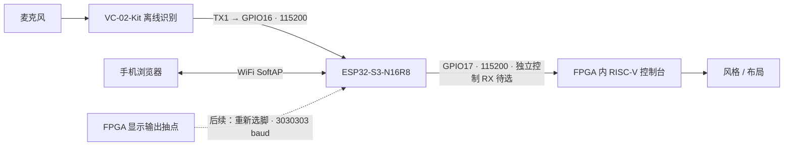

# ESP32-S3-N16R8 / VC-02-Kit 离线接入复核

**2026-10-20 后续更新：** 已核对 V4 主板及 QSE 转排针子卡的 J7/J28-37、39 为可用的
3.3V 引出点；用户目前好像没有子卡。实际接线、无子卡 USB 桥接及工具下载状态以
[接线与准备清单](wiring_20261020.md) 和 [准备包](../../../烧录文件/20261020_ESP32S3_VC02_Prepare/README.md)为准。
下文保留 10 月 19 日的检查范围与当时未完成项，不代表后续准备仍全部未做。

日期：2026-10-19。用户已确认 ESP32 型号为 **ESP32-S3-N16R8**；语音板资料为
**VC-02-Kit，VC-01/02-Kit B207 底板**。本轮仅做资料、现有源码和电路核对，
没有连接串口、烧录或操作板卡。实际 FPGA PCB 版本仍须在接线前与原理图核对。

## 1. 接入结论

建议 VC-02 负责离线识别，ESP32 统一接收语音和手机网页操作，把它们转换为
RISC-V 已支持的单字节命令。FPGA 继续处理摄像头、CNN 和 HDMI。

分两步接入：先验证语音和网页命令，再接视频预览。
**语音 / 网页控制本身不要求打开 `PHONE_PREVIEW`。**

现有 ESP32 sketch、五条语音规则和 RISC-V 命令解析已经存在。
**还不能直接照旧 README 接到 FPGA：有板载串口驱动和预览脚占用问题。**

## 2. 已确认的接口

### VC-02-Kit 与 ESP32

以下是后续实物连接方案，本轮不执行：

| VC-02-Kit 丝印 | ESP32 / 电源 | 用途 |
|---|---|---|
| `TX1` | `GPIO16` | UART2 RX，115200、8N1，接收识别结果 |
| `RX1` | 留空 | 目前只接收语音结果，不向 VC-02 发数据 |
| `VCC` | 稳定 5V，语音支路供电能力 >500mA | 按 Kit 规格供电，不能用 ESP32 的 3V3 |
| `GND` | ESP32 GND | 逻辑共地；将来再与 FPGA 共地 |
| `SPK+ / SPK-` 接口 | 配套 8Ω 2W 扬声器 | 语音回复；两个端子都接扬声器，不把 SPK- 当 GND |
| 麦克风接口 | 配套麦克风 | 不占用 ESP32 音频接口 |

`3V3OUT` 是输出；`SDA_5V / SCL_5V` 是另一路接口，本方案不用。
Kit 用 5V 供电，但 UART 是 3.3V 电平，可与 ESP32 GPIO 对接。
规格书引脚图是 **bottom view / 底视图**，实物以丝印为准，不能按图片左右直接数针。

后续供电可先让两块开发板分别通过各自 USB 供电，并共地，不再并接两块板的 5V。
如果改为单电源，再核对具体 ESP32 开发板的 5V 路径和两板总电流预算；
N16R8 只说明模组存储容量，不能证明底板电源承载能力。

### ESP32 与 FPGA 的逻辑接口

| ESP32 引脚 | 方向 | 协议 | 当前状态 |
|---|---|---|---|
| `GPIO17` | ESP32 → FPGA 控制 RX | 115200 8N1，单字节 ASCII | 命令可复用；实际接入脚 / 输入选择待落实 |
| `GPIO18` | FPGA 预览 TX → ESP32 | 3030303 8N1，96×54 RGB332 帧 | 后续阶段；当前正式位流不输出视频 |
| `GPIO15` | 不接 | — | 不需要额外语音 TX |
| `GND` | 共地 | — | 接线时确认 |

代码使用 UART1 只收预览，UART2 的 RX 接语音、TX 发控制命令。UART2 的两个方向
接不同设备是可行的：两边均为 115200 8N1，且没有要求向 VC-02 返回数据。
不能从 3030303 baud 的 UART1 发 FPGA 控制命令。

## 3. FPGA 电路复核发现的两处问题

依据本地厂商资料 `Ti60F225A_V4_SCH.pdf`，PDF 第 4、5、8 页；
不是只检查 Efinity 是否允许分配某个球位。

### 3.1 现有控制台 RX 已有板载 TX 驱动

现约束为 `uart_rx = GPIOL_02 / R4`、`uart_tx = GPIOR_28 / R14`，3.3V。
V4 原理图显示板载 FT4232HL 的 `CDBUS0` 通过 **R242 / 33Ω** 接到
`UART_TX_3V3`，再接 FPGA 的 R4；这是 **FTDI 发、FPGA 收**。
J8 的 6 脚也是这条网，J8 的 4 脚为 FPGA 发往 FTDI 的返回网。

所以 GPIO17 不能直接与这条网上的 FTDI TX 并接。关闭电脑串口软件只停止应用发送，
并没有隔离硬件输出；拔 USB 后 FTDI 的供电 / 输出状态也不能直接假定为高阻。

后续优先方案：找出可引出的独立 GPIO 作为 `ext_ctrl_rx`，在 FPGA 顶层选用
这个输入进入现有 Sapphire UART。RISC-V 的 `0/1/2/v/s` 解析可保持原样，
FPGA TX 仍可供电脑看日志。输入选择用明确的参数或选择信号，不能把外部两路 TX 电气并接。

这需要确认空闲 GPIO 的板级引出点、Bank 电压和输入电平，再改顶层、约束、构建验证。
若最终选中的扩展口只有 1.8V，ESP32 → FPGA 方向必须经过合适的电平转换。
V4 手册的 J7 扩展口包含不同 Bank，不能把整排都当作 3.3V GPIO。

另一种方法是隔离板载 FTDI TX 后复用 R4，但会涉及具体硬件改动与恢复，
本轮没有执行，也不把它作为默认连接方法。

### 3.2 `stream_tx` 的当前球位不是空闲排针

现约束为 `stream_tx = GPIOL_01 / R3`。V4 原理图第 8 页把 R3 接到
**`PHY_RST_N`**，第 5 页连接网口 PHY 的复位输入。
这说明“FPGA 逻辑未使用 / 约束能通过”不等于“底板有空闲排针”。

因此预览阶段应重新选定合适的可引出引脚，再做电平及信号完整性核对。
本轮没有移动约束，也没有把 PHY 复位网作为可直接使用的高速 UART 接口。
当前 `PHONE_PREVIEW=0` 时此输出保持高，开启预览后才会输出高速串口波形。

## 4. 语音命令与协议

在 [安信可语音开放平台](http://voice.ai-thinker.com/) 配置自定义命令并生成对应固件。
出厂灯控固件不等于已经包含“梵高 / 浮世绘 / 水墨”词条。
本轮没有登录账号或生成 / 下载 / 烧写自定义语音固件。
平台选择匹配 VC-02 的模板，并按官方平台教程保留 A28 使能低电平配置；
不要为处理 B6/B7 标注差异同时启用第二组 UART1。

建议先用唤醒词“你好画家”，命令输出如下。表中的 HEX 是**本项目约定**，
与 `esp32s3_stream/config.h` 已有 `VOICE_RULES` 对应，不是声称 VC-02 出厂就发送这些字节。

| 识别词 | UART 原始 HEX | ESP32 发给 FPGA | 含义 |
|---|---|---|---|
| 梵高风格 | `A1 00 01 01 FF` | ASCII `0`，HEX `30` | 风格 0 |
| 浮世绘 | `A1 00 02 01 FF` | ASCII `1`，HEX `31` | 风格 1 |
| 水墨画 | `A1 00 03 01 FF` | ASCII `2`，HEX `32` | 风格 2 |
| 切换画面 | `A1 00 04 01 FF` | ASCII `v`，HEX `76` | 循环布局 |
| 当前状态 | `A1 00 05 01 FF` | ASCII `s`，HEX `73` | FPGA 串口打印状态 |

平台填 HEX 时，`A1 00 01 01 FF` 是 5 个原始字节，不是这段字符的 ASCII 文本。
ESP32 转发的则是单个字符，例如 `0` 是 `0x30`，不是 `0x00`。
匹配器按 20ms 空闲间隔结束一段数据，帧长必须一致；同动作 300ms 内重复会被抑制。

语音回复先用“收到”之类短句。它表示模块识别了命令，**不等于 FPGA 已执行成功**。
目前 ESP32 不接收 FPGA 控制台回复，`/cmd` 的 `ok` 只代表发送请求完成；
网页 `/status` 是 ESP32 自身接收和命令计数。`s` 的结果要从 FPGA 串口日志看，
不会自动由 VC-02 播报，也不会自动变成网页里的 FPGA 状态。

## 5. VC-02 的 B6 / B7 文档差异

已比对官方资料：

| 资料 | 标注 |
|---|---|
| Kit 原理图 `VC-01-02-Kit_V1.0原理图20220120.pdf` | GPIO_B7/TX1、GPIO_B6/RX1 |
| 官方资料页所链接的平台教程 | GPIO_B7=UART1_TXD、GPIO_B6=UART1_RXD |
| VC-02 模组规格书 V1.0.2，2026-04-21，第 10 页 | TX1=GPIO_B6、RX1=GPIO_B7 |

本轮不能判定模组表格或图纸哪一处为笔误。Kit 接线按丝印 **TX1 → GPIO16**；
平台配置先按 Kit 教程准备 **B7 TX / B6 RX、115200 8N1**，上电时用原始字节抓包
确认真实输出，不能凭矛盾资料就承诺 B 编号一定正确。
`IOB8` 为日志口，不是本方案的识别结果接口。

## 6. 无板阶段完成项与后续顺序

### 本轮完成

- 核对现有 ESP32、RISC-V 源码、FPGA 参数与约束；确认命令接口一致。
- 核对用户截图、VC-02 官方资料、V4 FPGA 板原理图与硬件手册。
- 修正原接入说明的“空闲预览引脚 / 可直接接控制台 / B6、B7 无差异”等表述。
- 运行已有 Python 帧协议回归，通过 CRC 标准值、正常组帧、坏 CRC、超长帧拒收。

### 仍待完成，不计为已验证

1. 确认 FPGA 实物 PCB 版本，确定可接出的控制 RX；预览 TX 后续独立选脚。
2. 准备 Arduino ESP32 3.x 工具链，原生编译现有 sketch。
   使用 `ESP32S3 Dev Module`、16MB Flash、OPI PSRAM；USB CDC 设置按实际使用的
   原生 USB 或 USB 转串口口选择。现 sketch 启动即检查 PSRAM，即使暂不接视频也必须配置正确。
3. 在语音平台配置词条及 HEX 输出，保留 SDK、配置记录和对应更新固件。
4. 用户决定开始实物验证后，先只测 VC-02 → ESP32：看 USB `[voice]` 日志和 `/voice`；
   此时 GPIO17、GPIO18 均可不接 FPGA。
5. 处理控制 RX 后接入 FPGA；分别用网页按钮和语音检查三风格、布局及串口日志。
6. 最后处理预览 TX 引脚，独立构建 `PHONE_PREVIEW=1` 候选；重新验证资源、时序、
   三风格帧率、CRC、持续推流和控制并发。先保留当前正式版作为恢复基线。

本机未发现 Arduino CLI / ESP32 core 缓存；找到的主机 g++ 为旧 GCC 3.4.4，
无法运行要求 C++17 的完整桩回归。因此本轮没有宣称 Arduino 原生构建或完整 C++ 回归通过。
未修改 RTL、约束、RISC-V、运行时代码、正式位流或 Flash。

## 7. 资料与源码入口

- 用户提供的芯路城资源页：<https://www.xinlucity.com/?s=resourcedetail/index/id/61.html>。
  本次访问返回 403，未将其内容视为已读取；硬件参数由用户截图及官方资料交叉核对。
- [安信可 VC 系列资料页](https://docs.ai-thinker.com/vc/)：当前规格书、Kit 原理图、烧录工具、平台入口。
- [官方 Kit 原理图](https://aithinker-static.oss-cn-shenzhen.aliyuncs.com/docs/Public%20Document%20Center/VoiceModule/vc/SchematicDiagram/VC-01-02-Kit_V1.0%E5%8E%9F%E7%90%86%E5%9B%BE20220120.pdf)。
- [VC-02 模组规格书 V1.0.2](https://aithinker-static.oss-cn-shenzhen.aliyuncs.com/docs/Public%20Document%20Center/VoiceModule/vc/Specification/VC-02_V1.0.2%E8%A7%84%E6%A0%BC%E4%B9%A6-20260421.pdf)。
- [官方资料页链接的平台教程](https://blog.csdn.net/Boantong_/article/details/124689101)。
- [ESP32-S3-DevKitC-1 参考](https://docs.espressif.com/projects/esp-dev-kits/en/latest/esp32s3/esp32-s3-devkitc-1/user_guide_v1.1.html)：只作模组 GPIO / 电源参考，实际到货底板以其图纸为准。
- 本地 V4 电路资料：`C:/Users/lingye/Desktop/FPGA/FPGAProjects/reference/board/Ti60F225A_V4_SCH.pdf`。
- 本地 V4 手册：同目录 `TI60F225I3-V4 DEMO板软硬件设计说明-260813-1.pdf`；原厂家例程源码已集中到 `FPGAProjects/_archive/厂家例程_20261023/vendor_sources.zip`。
- [ESP32 sketch](../esp32s3_stream/esp32s3_stream.ino)、[配置与语音规则](../esp32s3_stream/config.h)。
- RISC-V 控制台：`../../embedded_sw/soc/software/standalone/stylecam/src/main.c`，`console()`。
- FPGA 顶层与约束：`../../rtl/ti60f225_oob_top.v`、`../../ti60f225_oob.peri.xml`。
