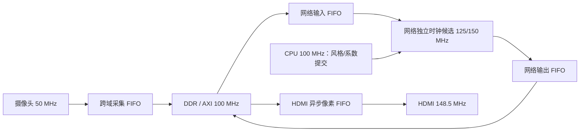

# StyleCam 资源优化与效果升级建议

日期：2026-10-11。依据：当前工程 RTL、交接文档、2026-10-09 RISC-V 08 发布报告和串口验证记录。

## 1. 结论

目前的限制是逻辑和片上 RAM，DSP 还有余量。最值得先改的是 **IN 系数计算的 160 位通用算术单元**：它消耗大量逻辑，而且卡住核心时钟。网络帧率最值得先改的是 **末层卷积的并行度和等待 HDMI 换帧的调度**。

增加网络参数有可行方向。优先试“共享主干 + 每种风格独立的最后一层/两层权重”，利用现有权重 RAM 未使用的深度，参数可由 11,028 增至 14,508/15,276，每帧 MAC 数不变。这里的 RAM 块数不增长属于结构估算，须综合验证；画质收益须重新训练和实拍验证。

建议顺序：**补齐测量 → 折叠 IN 算术 → RAM/FIFO 整理 → 末层加并行与帧调度解耦 → 风格专属输出头 → 画质与手机体验**。首先以稳定 20 FPS 为工程目标，再验证 30 FPS 所需的时钟、带宽和并行度。

本文的“实测”来自已保存的 08 报告与日志；“推导”来自当前 RTL 和模型定义；“目标/候选”均未经过新一轮综合、布局布线或上板。历史文档中的网络冻结、赛题对齐建议作为背景，本次以效果与资源效率为判断依据。

## 2. 当前实现与实测基线

- 器件：Ti60F225，当前网络/CPU/DDR AXI 核心域为 100 MHz。
- 摄像头：SC431HAI，1920×1080 RAW10，约 30 FPS；使用高 8 位，扣黑电平，BGGR 5×5 MHC 去马赛克、Gamma，中心裁剪 1280×960 后 2×2 平均成 640×480 RGB，再水平镜像写 DDR。
- 网络：V21b，C=24、Fc=16、4 个 dw1 残差块，13 层，INT8；13 层同时存在，按 valid/ready 流式工作。
- IN：每种风格初始校准需 13 次完整遍历；稳定运行每帧推理一次、轮换刷新一个归一化层。不能将其理解为“每帧完整计算所有层当前帧 IN”。
- 存储：三份输入 DDR 帧缓冲、两份输出 DDR 帧缓冲。HDMI 为 1080p60；画面实际信息分辨率为 640×480，放大主要使用最近邻。
- 交互：KEY3 风格切换、KEY2 三种布局、UART `0/1/2/v` 已有实现。最新 UART 日志验证了布局切换，但 `k2/k3/sw_us` 为 0，不能证明实体按键及可见切换延迟已验收。
- 最新稳定日志：输出 14.99～15.00 FPS，摄像头 29.9～30 FPS，`pass_ms=59.2～59.3`，`nn_ms=59.3～59.4`，日志区间内摄像头/视频/HDMI错误及欠流为 0。
- 手机视频传输、手机控制页面、摄像头到手机画面的端到端延迟测量尚未实现。

证据：[交接文档](C:/Users/lingye/Desktop/FPGA/FPGAProjects/docs/项目交接文档_20261009.md)、[摄像头对齐与冲突](C:/Users/lingye/Desktop/FPGA/FPGAProjects/docs/摄像头参考对齐与资源冲突_20261009.md)、[最新串口日志](C:/Users/lingye/Desktop/FPGA/FPGAProjects/StyleCam_camera/validation/camera_native_rgb_mirror_uart_checks.log:7)。

## 3. 资源占用大头

### 3.1 布局布线后的整机占用

| 资源 | 已用/总量 | 占比 | 剩余 |
|---|---:|---:|---:|
| XLR | 60,399 / 60,800 | 99.34% | 401 |
| RAM10 | 246 / 256 | 96.09% | 10 |
| DSP | 121 / 160 | 75.62% | 39 |
| 全局时钟缓冲 | 12 / 32 | 37.50% | 20 |

整机 XLR 中，单独使用 FF 的位置占 11,626，LUT+FF 占 8,244；寄存器数量、控制集合、算术逻辑打包与布线都影响最终面积。下面的模块表来自 **综合层级估计**，不能把 LUT、FF、加法器、SRL 相加当成模块实际 XLR。

证据：[place.rpt](C:/Users/lingye/Desktop/FPGA/FPGAProjects/烧录文件/20261009_RISCV08_BGGR_RGBMirror/place.rpt:119)、[map.rpt](C:/Users/lingye/Desktop/FPGA/FPGAProjects/烧录文件/20261009_RISCV08_BGGR_RGBMirror/map.rpt:3808)。本次解析了 392 条层级记录，并验证顶层各子模块资源加和一致。

### 3.2 模块综合估计

| 模块 | LUT4 | FF | 加法器 | SRL | RAM10 | DSP |
|---|---:|---:|---:|---:|---:|---:|
| 神经网络 `engine/net` | 16,003 | 10,477 | 4,204 | 2,746 | 128 | 117 |
| IN 刷新 `engine/in_update` | 5,464 | 2,178 | 1,642 | 0 | 17 | 0 |
| DDR 控制器 | 3,333 | 2,503 | 280 | 784 | 22 | 0 |
| 摄像头 RGB 预处理 | 3,324 | 1,159 | 1,087 | 11 | 11 | 4 |
| RISC-V SoC | 2,337 | 1,865 | 336 | 0 | 24 | 0 |
| CSI 接收 | 2,165 | 1,188 | 218 | 0 | 11 | 0 |
| HDMI 编码部分 | 897 | 617 | 180 | 248 | 2 | 0 |
| 显示缓存/OSD/搬运 | 645 | 1,036 | 208 | 0 | 22 | 0 |
| 帧采集 DDR 写入 | 463 | 542 | 32 | 0 | 3 | 0 |
| DDR 输入回放 | 314 | 403 | 156 | 0 | 6 | 0 |

网络和 IN 合计占约 60.0% 的 LUT、58.9% 的 RAM，以及全部 121 个 DSP 中的 117 个。两个按键各只有 10 个 LUT；删除基础交互带来的收益很小。

RISC-V 当前为 RV32I，16 KB RAM，乘除法和桶形移位器已关闭，缓存、CPU DDR 访问和部分外设也已裁掉。固件 RAM 占用约 13,968/16,384 字节，继续裁 CPU 应结合软件功能和链接图；将 160 位 IN 运算搬到 CPU 不应视为免费优化。

### 3.3 网络 RAM 的用途

| 用途 | RAM10 块数 |
|---|---:|
| 卷积行缓冲 | 63 |
| 卷积权重 | 44 |
| 各层 requant/IN 系数 | 13 |
| IN 统计 | 5 |
| Pixel shuffle | 3 |
| 合计 | 128 |

卷积权重只有 **9,384 个 INT8 数**，约 9.38 KB，却占 44 个 10 Kbit RAM，物理位容量约 56.32 KB，原始权重位占用约 16.7%。原因是 MAC 每拍需同时读许多权重，形成“很宽、很浅”的 RAM。减少权重字节数未必减少 RAM 块数；减少并行读宽度通常又会降低帧率。

现有优化不能重复计收益：IN 常量已无损压缩；`IN_TRACE=0`；权重 CPU 写口已将 32 位 lane 拼成整行；requant 系数已做 19+19 位打包；`swg3b` 已使用两行缓存。交接文档中的这些改动已经进入本次基线。

## 4. 优先优化方案

### 4.1 P0：将 IN 运算改成按字折叠的算术单元

`sc_in_alu` 虽然按位迭代执行乘法、除法和开方，但每拍仍使用 160/161 位的加减、比较、选择。`sc_in_math` 还保留大量 160 位临时寄存器、宽移位、偏置加法。这种结构同时消耗逻辑和长进位路径。

建议实现步骤：

1. 用一个 32 或 40 位加减单元，分 5 或 4 个字完成宽运算，逐字传播 carry/borrow。
2. 宽临时数复用寄存器组或小 RAM，避免为每个阶段保留完整宽数据通路；先评估 RAM 代价，当前 RAM 也紧张。
3. 分离除法最终的余数比较、舍入判定和加一，缩短当前同拍路径。
4. `2^k` 除法使用移位及 guard/round/sticky 位，严格保留最近偶数舍入；不要沿用通用 160 位除法流程。
5. 对各阶段做范围推导后再缩位宽，保留 Q40 精度、符号、饱和、零样本与异常行为。

IN 刷新没有占 DSP，优先折叠加减逻辑更符合目前瓶颈。可以再单独评估少量 DSP 加速必要乘法，但应给末层卷积加并行保留 DSP 预算。

验证入口：已有 IN 数学验证记录和 3,273 个向量。改动后逐位对照软件黄金结果，覆盖除法半整数、负 gamma/beta、低方差、大统计值与错误处理，再运行整帧验证。

从当前 `nn_ms` 与 `pass_ms` 差值看，刷新/调度额外时间相对 59 ms 的推理较小，允许用少量周期交换面积；具体增加多少时间仍要用 `auto_math_cycles` 测量。可以把“节省数千 XLR”作为试验目标，不能在新布局报告出来前认定达成。

源码：[sc_in_alu.v](C:/Users/lingye/Desktop/FPGA/FPGAProjects/StyleCam_camera/rtl/sc_in_alu.v:3)、[sc_in_math.v](C:/Users/lingye/Desktop/FPGA/FPGAProjects/StyleCam_camera/rtl/sc_in_math.v:17)。

### 4.2 P0：编译设置与数据通路的低成本试验

当前项目 `retiming=0`、`seq_opt=0`、`optimize-adder-tree=0`。建立独立候选构建，分别试验面积/速度策略、retiming 1/2、顺序优化和加法树优化。每次只比较一个因素，记录实际 XLR、RAM、DSP、各时钟 setup/hold 和视频正确性。官方说明 retiming 可以移动或复制寄存器，顺序优化可能改变面积，因此没有“打开即省资源”的保证。[Efinity 时序收敛指南](https://www.efinixinc.com/docs/efinity-timing-closure-v7.6.pdf)

层内可再检查：`requant` 的宽乘加/饱和判定、`swg3b` 的地址与多路选择、`mac_dense` 的 16 位输入索引及 8 位组/通道索引。用参数推导最小宽度，保持边界和握手正确。末层 requant 的综合 LUT 为 1,746，前两层分别为 958/967，是值得深入看映射的对象；仅凭模块表不能断定所有这些 LUT 都能删除。

Ti60 支持多种 DSP 模式，但当前乘法为 int8 权重乘 uint8 激活，激活显式扩成 9 位有符号数；不能直接承诺“一块 DSP 放两个现有乘法”。若试双乘打包，必须证明符号修正、控制集合和输出精度，并检查综合 DSP 打包结果。[Ti60 数据手册](https://www.efinixinc.com/docs/titanium60-ds-v3.7.pdf)、[Efinity 综合指南](https://www.efinixinc.com/docs/efinity-synthesis-v4.7.pdf)

### 4.3 P1：整理 FIFO 和 RAM 布局

| 缓冲 | 当前结构 | 判断与动作 |
|---|---|---|
| 摄像头采集 FIFO | 50 位×512，3 RAM | 真实跨域，保留 CDC；深度按写入阻塞实测决定 |
| 回放 FIFO | 128 位×64，6 RAM | 当前两端都是 core_clk，可改同步 FIFO；进一步处理像素填充位和存储宽度 |
| 网络输出上传 FIFO | 148 位×64，8 RAM | 当前两端都是 core_clk，可改同步 FIFO；将可重建的 bank/index/首末标记从逐字数据中拆出 |
| HDMI 像素 FIFO | 96 位×512，5 RAM | 真实跨域且需覆盖显示读延迟，保留容量保障 |
| HDMI 行缓存 | 96 位×320，5 RAM | 扩展控制使原图/风格全屏的重复行也复用，降低 DDR 读流量 |

改同步 FIFO 主要减少 Gray 指针、同步器和等待延迟，**不自动减少原数据 RAM 块数**。若后续网络提到独立时钟，回放/上传边界重新成为真实 CDC，必须保留异步 FIFO；不能同时计算这两种互斥设计的收益。

权重 RAM 的空闲深度可先用于增加风格参数。另一候选是用更快的 RAM 时钟顺序读出权重再拼宽，但这会增加时钟、寄存器和时序难度，优先级较低。

### 4.4 P1：DDR 事务效率

当前写端 `AWLEN=0`，逐个 16 字节事务依次等待 AW、W、B；读端固定 16 拍突发，读仲裁给 HDMI 优先。这使协议往返与局部等待值得检查，但不能仅凭平均流量认定 DDR 总带宽已经耗尽。

按 32 位存储像素估算有效载荷：摄像头写 36.864 MB/s，15 FPS 网络读/写各 18.432 MB/s，HDMI 当前读取 147.456 MB/s，总计约 **221.184 MB/s**，未含协议开销。将全屏模式重复行改为复用现有行缓存，可把这两种模式的 HDMI 读取降至约 73.728 MB/s；左右对比模式不变。

之后考虑 8/16 拍写突发和 AW/W/B 流水化。镜像采集的倒序写需要先形成地址递增的突发数据；最后一笔 B 响应及错误必须进入帧提交条件。读仲裁以 HDMI FIFO 水位/显示期限保护输出，再给网络公平服务。先增加双方等待计数，确认收益来源。

## 5. 帧率和时序的具体限制

### 5.1 当前时序

| 域 | 频率 | 最差 setup 余量 | 解释 |
|---|---:|---:|---|
| DDR `rx_cal_clk` | 400 MHz | +0.395 ns | 整机最小值，DDR 复位/校准相关路径 |
| `core_clk` | 100 MHz | +1.337 ns | 核心最长路径在 IN 算术 |
| CSI 像素域 | 50 MHz | +7.854 ns | 当前余量较大 |
| HDMI 像素域 | 148.5 MHz | +2.079 ns | 当前余量较大 |

核心路径为 `engine/in_update/math/alu/rem[40]` 到 `engine/in_update/math/result[153]`，数据延迟 8.404 ns、168 级逻辑。报告给出的核心可分析最高频率约 **115.433 MHz**，因此直接将当前核心改成 125/150 MHz 没有依据。核心最小 hold 余量为 +0.026 ns，权重写 RAM 路径也需随布局重查。

优先缩短 IN 路径，再考虑把网络独立到 125 MHz、继而 150 MHz，CPU/DDR AXI 保持原域，通过真正的 CDC 边界交换像素、配置与帧描述符。需要核实 PLL 输出、时钟缓冲和 reset 约束。DDR 域的 400 MHz 与网络频率不是同一个提频问题。

当前 SDC 使用了跨时钟路径屏蔽；新增 CDC 时需检查 Gray 指针偏斜、握手数据保持时间、复位释放和跨域配置提交。添加 false path 不能替代这些设计验证。最新发布目录未保存完整 CDC 报告和布局后的模块利用率报告，下一次候选构建应一并归档。

证据：[timing.rpt](C:/Users/lingye/Desktop/FPGA/FPGAProjects/烧录文件/20261009_RISCV08_BGGR_RGBMirror/timing.rpt:4058)、[编译参数](C:/Users/lingye/Desktop/FPGA/FPGAProjects/StyleCam_camera/ti60f225_oob.xml:96)。

### 5.2 各层服务时间下界

按当前 MAC 和 requant 结构，在 100 MHz 下推导稳态服务下界。各层已同时流水，整网时间主要由最慢层、填充/排空和阻塞决定，不能将所有层时间相加。

| 层 | 主要结构 | 下界周期/帧 | 100 MHz 时间 |
|---|---|---:|---:|
| l0/e1 | 3×3，stride2，3→16，PE4 | 2,764,800 | 27.648 ms |
| l1/e2 | 3×3，stride2，16→24，PE4 | 4,147,200 | 41.472 ms |
| l2/4/6/8 | 24 通道深度卷积 | 每层 1,036,800 | 每层 10.368 ms |
| l3/5/7/9 | 24→24，1×1，PE1 | 每层 2,764,800 | 每层 27.648 ms |
| l10/d1a | 上采样后深度卷积 | 4,147,200 | 41.472 ms |
| l11/d1b | 24→16，1×1，PE2 | 3,686,400 | 36.864 ms |
| **l12/d2** | **16→12，3×3，PE6** | **5,529,600** | **55.296 ms** |

l12 是当前首要计算瓶颈。55.296 ms 的下界对应 18.08 FPS，整帧实测约 59.3 ms，再遇 HDMI 换帧等待，最后发布约 15 FPS，数量关系吻合。

### 5.3 有预算地提高并行度

把 l12 PE6 改成 PE12，MAC 并行乘法由 24 路变为 48 路。结构估计：

- 总 DSP 由 121 增至约 145，增加 24。
- l12 权重 RAM 从约 10 增至 20，总 RAM 从 246 到 **256**；逻辑也会增加，当前无法直接塞进去。
- l12 服务下界减半，整网最慢层转到 l1/l10 的约 41.472 ms。
- 100 MHz 下适合作为 20 FPS 候选；125 MHz 下下界 33.178 ms，留给排空/DDR 等待的余量不足，不能保证 30 FPS；150 MHz 下下界约 27.648 ms，才形成更合理的 30 FPS 验证空间。

这些是硬件结构推导，最终 DSP/RAM/XLR 和帧率须重新构建确认。仅把现有 PE6 网络提到 150 MHz，其下界仍为 36.864 ms，达不到 30 FPS。

## 6. 异步与流水线设计

### 6.1 已经有的设计

层间 valid/ready 流水、摄像头域到核心域的 FIFO、核心域到 HDMI 域的 FIFO 已经存在。当前不足主要是帧级调度耦合、宽算术路径与部分同域缓冲效率。

`sc_video_schedule` 为 `WAIT → START → RUN → DRAIN → SWAP → WAIT`。DRAIN 等输出写入完成后发布；SWAP 再等 HDMI 接收新 bank，才启动下一次推理。CPU 在发布 IRQ 中已经发起下一帧 step，但仍被 SWAP 门限挡住。

### 6.2 建议的帧级解耦



时钟分离解决各域的时序与握手，**第三份输出 DDR 帧缓冲和明确的 bank 所有权**解决等待显示的停顿。两者作用不同。

输出 bank 状态建议为 `FREE / WRITING / COMPLETE / PENDING / READING`。网络只能领取 FREE bank，最后 DDR 响应成功后进入 COMPLETE，显示在垂直消隐期接收 PENDING 并归还旧 READING。无法直接删除当前 SWAP：两输出 bank 在“旧帧显示+新帧待显示”时都被占用，会覆盖画面。

第三份输出是 DDR 容量，640×480×4 约 1.23 MB，无需整帧片上 RAM。每个描述符携带输入 bank、输出 bank、frame_id、style、时间戳和有效性。左右对比显示必须保留对应原图。三输入 bank 在同时保留原图、待显示原图、计算中输入和摄像头采集时可能不足，需评估第四输入 bank 或明确定义丢帧策略。

低延迟模式优先取最新完成的摄像头帧，并允许替换尚未显示的旧结果；不要累积长 FIFO 队列。保留帧级风格原子性和 IN 参数提交规则，显示交接用请求/确认握手，不能依赖任意多位总线各自两级同步。

旧 DDR 地址目前输入为 0/2/8 MiB、输出为 4/6 MiB，新增地址需做完整分配表，不能复用已有地址。

### 6.3 面积很大但代价也大的方案

把四个残差块折叠成一个共享硬件，按当前模块表可减少约 39 个 RAM、33 个 DSP（未计新增中间缓存/控制）。但一次 160×120×24 的 INT8 特征约 460.8 KB，需 DDR 存中间结果，四次计算串行，会增加流量、帧延迟并削弱帧率。它适合低帧率大模型试验，当前实时视频主线应优先优化 IN 和关键层。

## 7. 网络参数还可以增加吗

可以，但需要同时考虑学习容量、RAM 读宽度和每帧计算量。现有模型参数统计包含三种风格的仿射参数：卷积 9,384、仿射 1,632、输出偏置 12，共 11,028。48616 字节 Flash blob 包含配置记录/地址等开销，不等于学习参数体积。

### 7.1 首选：利用权重 RAM 深度做风格专属输出头

| 方案 | 参数数 | 相比基线 | 每帧 MAC |
|---|---:|---:|---:|
| 当前共享权重 | 11,028 | — | 339,148,800 |
| 最后一层 l12 三套风格权重/偏置 | 14,508 | +31.56% | 339,148,800 |
| 最后两层 l11/l12 三套风格权重 | 15,276 | +38.52% | 339,148,800 |

每帧只读一个风格 bank，复用原 MAC 和 requant。l12 现有权重行是 192 位×72，三 bank 为 192 位×216；l11 是 64 位×48，三 bank 为 64 位×144。两者均未超过 RAM 的 512 深度范围，保持当前读宽度时，理论上仍可用原块数。若同时将 l12 改 PE12，则它原本增加的 RAM 读宽度成本仍要计算。

实现需把 `waddr=i0*NF+f0` 改为 `style*WD+i0*NF+f0`，扩大 RAM 深度与地址宽度，修改导出/装载记录。末层偏置也要按风格处理；逐风格校准量化尺度和 IN 常量。风格索引需锁定至整帧结束。

训练上保持共享主干，分别优化各风格输出头，用均衡样本、蒸馏、QAT 和连续帧评估验证。已有 V21 试验记录显示共享权重调整可能改善一个风格而损害另一个，这个结构值得用于降低输出端风格冲突，但并不保证增加参数一定改善画质。

依据：[mac.v 权重地址](C:/Users/lingye/Desktop/FPGA/FPGAProjects/StyleCam_camera/rtl/mac.v:35)、[模型定义](C:/Users/lingye/Desktop/FPGA/FPGAProjects/StyleCam/algo/tinystyle.py)、[V21 优化记录](C:/Users/lingye/Desktop/FPGA/FPGAProjects/StyleCam/docs/v21_targeted_optimization_20261005.md)、[Ti60 RAM 组织](https://www.efinixinc.com/docs/titanium60-ds-v3.7.pdf)。

### 7.2 扩宽、加深候选

| C/Fc/残差数 | 参数数 | VGA MAC/帧 | MAC 增幅 | 主要代价 |
|---|---:|---:|---:|---|
| 24/16/4 | 11,028 | 339,148,800 | — | 当前基线 |
| 24/16/5 | 12,108 | 354,355,200 | +4.48% | 新增一对 DW/PW 硬件 |
| 28/16/4 | 12,920 | 376,627,200 | +11.05% | 特征行缓冲与并行通路增长 |
| 32/16/4 | 14,940 | 416,563,200 | +22.83% | 特征行缓冲与 MAC 增长更大 |
| 24/20/4 | 12,576 | 404,582,400 | +19.29% | 编码/解码宽度及末层负载增长 |

新增一个残差块，按当前一对层约需至少 13 RAM、11 DSP、约 2,158 LUT，尚未包含 IN 常量和控制变化；当前只剩 10 RAM，不能直接加。其空间分辨率低、MAC 增幅较小，作为第二顺位容量候选比盲目扩 Fc 更合理。

这些参数来自模型纯函数，不代表生成器可以原样接受：要重查 GI/PE 整除、13 层固定编号、IN 统计尺寸与轮换、量化常量、CPU blob、仿真和完整布局。不能仅更改 Python 的 C 就烧录。

## 8. 把资源投入更好的效果

### 8.1 画质

1. 固定光线、镜头焦点和测试场景，使用细字、斜线、肤色、暗部、运动画面分别比较原图和各风格。先区分传感器模糊、放大锯齿、网络细节损失与时域闪烁。
2. 优先做训练样本与真实摄像头的亮度/颜色匹配、量化校准、风格蒸馏和时域一致性；这些改进可保持 FPGA 拓扑和资源。
3. 利用已有统计和 CPU/I2C 做低频 AE/AWB 或亮度/饱和度控制，帧边界提交并平滑更新。先用均值/饱和比例；四路完整直方图会增加资源。
4. 如放大锯齿明显，可评估显示端双线性插值与邻行缓存成本。1080p HDMI 输出不代表模型已有 1080p 细节；单纯锐化可能放大噪声和风格闪烁。

建议把节省的逻辑优先分给帧率、测量和稳定控制；利用现有权重深度提升风格容量。容量、帧率、时域稳定性的对比应放在同一组实拍数据上。

### 8.2 交互与延迟测量

基础切换代码已经存在，下一步是实体按键验收、手机交互以及“请求已接收/新风格已显示”的两级反馈。控制每帧锁定风格，连续命令可采取下一帧开始前最后一次请求生效。

现有 `sw_us` 在 `IRQ_PUBLISH` 时结算，代表请求到输出发布；发布发生在 HDMI 真正显示前。它不是按键到可见画面延迟，更不是手机端延迟。`nn_ms≈59.4` 同样只是 NN job 时间。

已有 `first_output_cycles`、`input_stalls`、`output_stalls` 信号，但当前没有完整暴露到 APB/串口。先补：采集 frame_id/时间戳、推理开始/首输出/结束、DDR 提交、SWAP 等待、HDMI 实际扫描 frame_id，以及输入/输出/仲裁阻塞计数。跨域时间戳应转换到统一时基或使用关联事件，不能直接相减不同频率计数器。

验收分别报告 NN 时间、采集到 HDMI、指令到新风格可见、采集到手机的 p50/p95，以及丢帧、欠流和错误数。用高帧率拍摄同步 LED/秒表画面进行可见延迟校验。

### 8.3 手机视频与控制

推荐结构：**FPGA HDMI → HDMI 采集/网关 → H.264 等硬件编码 → WebRTC → 手机浏览器**；手机按钮经网关串口发送当前 `0/1/2/v` 控制命令。先确认现有采集设备和实际 PCB 接口，再选网关硬件。

未压缩 VGA RGB24，15 FPS 为 13.824 MB/s（110.592 Mbit/s），30 FPS 为 27.648 MB/s（221.184 Mbit/s）。115200、8N1 UART 只有约 11,520 字节/秒，适合控制和指标，无法承担视频。

WebRTC 是合理的低延迟浏览器入口；MediaMTX 官方说明 HLS 延迟通常更高，实际编码、浏览器兼容和网络状况需验证。[MediaMTX 浏览器读取文档](https://mediamtx.org/docs/read/web-browsers)

该方案把视频编码和联网放在网关，FPGA 用于风格处理、画面和交互。当前 RTL 没有已验证的手机视频网络链路；在现有 99% 逻辑占用上增加完整编码器/网络栈，投入和资源代价都很高。

板级接口需按真实原理图确认：当前工程使用 DDR3，而 Efinix 官方 Ti60F225 开发套件文档是另一套存储/接口组合。因此不能仅凭 FPGA 型号认定本板拥有官方套件的 SD、USB3 或以太网硬件。SD 卡可以用于资源文件/记录，不能增加 FPGA 的 XLR、RAM 或 DSP。

## 9. 实施顺序和通过条件

| 阶段 | 具体交付 | 通过条件 |
|---|---|---|
| A：可测基线 | 曝光/场景固定；APB 计数与帧标识；实体按键测试 | 现有 15 FPS 正确性保持，得到真实等待时间和可见延迟分布 |
| B：释放资源 | 精确折叠 IN；编译策略 A/B；FIFO/存储整理 | 数学黄金结果通过；全时钟 setup/hold/CDC 通过；资源明显下降；长时间三布局/三风格无错误 |
| C：提高帧率 | l12 PE12；DDR 行复用/突发；输出三缓冲调度 | 先实测稳定 20 FPS，验证捕获丢帧策略和原图对应关系 |
| D：30 FPS 候选 | NN 独立 125→150 MHz，瓶颈层与 DDR 联调 | 每帧完整服务时间有小于 33.33 ms 的裕量，帧发布/显示保持稳定，延迟不因排队增加 |
| E：画质容量 | 风格专属末层/两层训练、量化、权重 bank | 相同场景同等帧率比较，风格细节改善且闪烁/色彩/肤色没有不可接受退化 |
| F：手机体验 | 网关视频、手机控制、状态确认、端到端测量 | 手机稳定观看和切换，记录 p50/p95、编码/网络/显示各段耗时 |

可先以 **XLR ≤55,000、RAM ≤230** 作为释放阶段的预算目标，为加并行及后续功能留出余量。这是工程门槛建议，尚未证明可以达到；若优化后达不到，应按实际节省量缩小并行/功能组合。

帧率与画质候选应分开 A/B 验证，再组合构建；避免同时修改网络、时钟、DDR 和传感器，导致故障无法归因。每个可用版本保留 bitstream、固件、参数 CRC、报告、日志和实拍样本。

## 10. 审计数据与复算

- [结构化审计 JSON](C:/Users/lingye/Desktop/FPGA/FPGAProjects/docs/资源与性能审计_20261011.json)：392 条模块层级、整机资源、时序摘要、网络 RAM 分项、逐层周期下界、模型容量候选、风格输出头候选及源报告 SHA256。
- [复算脚本](C:/Users/lingye/Desktop/FPGA/FPGAProjects/tools/resource_audit_20261011.py)：Python 标准库即可，读取保存的报告和当前模型/RTL；模型部分只执行纯架构函数，无需导入 PyTorch。

```powershell
python -X utf8 -B C:\Users\lingye\Desktop\FPGA\FPGAProjects\tools\resource_audit_20261011.py
```

本次脚本已成功运行并完成层级加和、13 层提取、总 MAC 及 128 块网络 RAM 分项核对。上述建议尚未产生新的优化后资源/时序或上板结果。
