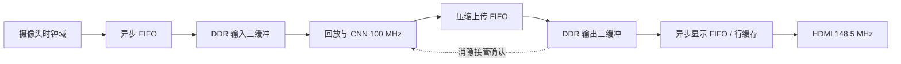

# 资源、吞吐与显示流水优化实施记录

源码分支：`codex/resource-throughput-20261013`；基线：`77e5838` / 已验收 RISC-V 08。新寄存器 ID：`53430a09`。本文记录实际实现及验收边界，最终构建数据以随包 manifest 和 Efinity 报告为准。

**最终状态：完整综合、布局布线、时序检查、固件更新与 BIT/HEX 生成均已通过，离线候选已打包。按用户最新要求，未下载到板卡、未写 Flash。**

产物位于 [20261014_RISCV09_Optimized_Candidate](../烧录文件/20261014_RISCV09_Optimized_Candidate/README.md)。

## 已实现

1. **IN 算术折叠**：160 位乘除、开方、加减、舍入共用 32 位逐字运算通路，跨字进借位保存在寄存器；保留最近偶数舍入、饱和和零除约定。对统计量的中间宽度作有证明边界的收缩。牺牲单个系数计算周期以降低宽加法器数量，不降低系数精度。
2. **末层并行度 6→12**：`mac_dense.CFG_PE` 将旧 PE6 权重记录映射到 PE12 物理地址/通道。4050 条原始模型记录可以原样装载；模型 CRC 仍为 `373deed7`。该映射针对 CPU 配置写入，另行使用 WFILE 初始化时仍需按物理 PE 重新排布文件。
3. **异步 FIFO 存储收紧**：回放去掉每像素 8 位 DDR 填充；上传改为 28×256 像素 FIFO，在 AXI 域拼 128 位数据。上传缓存仍容纳 256 像素，合计省 7 块 RAM10；PE12 新增 10 块，净增加 3 块。
4. **三个输出缓冲与帧调度重叠**：输出 DDR 基址为 `0x400000 / 0x600000 / 0xa00000`。写入、待显示、当前显示三种所有权独立；等待 HDMI 消隐切换时可处理下一帧。输入继续沿用原来的三缓冲和原画配对机制。发布描述符用 toggle 握手跨域，数据保持至接管确认。
5. **全屏重复行复用**：原画/风格 2× 全屏的第二条重复行使用现有行缓存，显示 DDR 读取量减半。对比模式仍需读取原画和风格两个源。
6. **可观测性**：APB 增加首输出周期、输入/输出阻塞、自由运行时钟、显示接管序号/时间/风格、发布等待时间。固件状态命令新增 `perf` 行；原 `sw_us` 仍代表请求到发布，`scan_sw_us` 代表请求到 DDR 显示扫描接管。后者也早于真实屏幕发光，不能作为手机或 camera-to-photon 延迟。
7. **综合策略**：area、seq_opt、adder-tree 优化，保持原时钟与时序约束。没有靠放宽时钟、屏蔽新增关键路径来报告成功。

当前顶层网络、回放和 AXI 控制仍同为 core_clk=100 MHz；真正的异步时钟边界在摄像头输入和 HDMI 输出。上传 FIFO 支持异步，测试用独立时钟验证，但本板连接下其两侧同频同源。这里的帧流水改进是缓冲所有权与任务重叠，不是给神经网络凭空增加独立时钟。



显示当前帧时，另一个输出银行可等待消隐，第三个银行可被网络写入；原画银行随对应风格帧一起交接。输入摄像头不能背压，银行不足时仍按完整帧跳过，不能通过覆盖正在显示/运算的银行制造虚假高 FPS。

## 资源

| 项目 | 08 基线 | 本版布局结果 | 变化 |
|---|---:|---:|---:|
| XLR | 60399/60800 | 58785/60800 | -1614，空余 2015 |
| RAM10 | 246/256 | 249/256 | +3，空余 7 |
| DSP | 121/160 | 145/160 | +24，空余 15 |

IN refresh 综合分项：LUT 5888、ADD 230、FF 2090、RAM 17。相比旧版 LUT 5464 / ADD 1642 / FF 2178，LUT 并未单独减少；收益来自宽加法器大幅减少和整体映射。不能将 LUT、FF、ADD 简单相加作为 XLR。

第一版旋转寄存器实现加 speed 综合曾超出容量，已被逐字索引实现替换。最终布局数字包括末层提速、三缓冲和遥测新增开销。

## 最终布线与时序

TIMING_3 配方在 60 轮后仍有 74 个冲突，未用于交付；改用 **CONGESTION_3、seed=0** 后完成布线，PNR 返回 PASS。最终 STA：

| 检查 | 结果 |
|---|---:|
| 全局最小 setup | +0.127 ns |
| 全局最小 hold | +0.026 ns |
| core_clk setup | +1.124 ns，100 MHz 约束 |
| HDMI setup | +2.007 ns，148.5 MHz 约束 |
| core_clk 报告的分析频率上限 | 112.663 MHz |

核心最差路径由原 168 级宽运算链变为 `alu/y[26] → alu/x[155]` 的 7 级控制路径，但布线与高扇出使最终核心裕量仍比旧版 +1.337 ns 小；全局最小裕量也比旧版 +0.395 ns 小。**本轮是原时钟下资源/吞吐优化并完成时序收敛，不能宣称提高了全局 Fmax，更不能据此直接超频。**

## 仿真与固件

- `sim_optimization.py`：1260 个全宽算术参考向量；异步上传三输出银行共 1536 像素，覆盖满 FIFO、背压、延迟写响应、末次 B 错误及复位。
- `sim_in_math.py`：3273 个 IN 向量，与官方 golden 一致；包括 VGA 图像统计。最大系数计算 3318 周期（100 MHz 下 33.18 μs）。
- `sim_camera.py`：摄像头 RGB、输入三缓冲、输出三缓冲所有权、调度重叠、显示提交、APB 映射。
- `sim_display_pressure.py`：并发回放和 90 周期 DDR 延迟下，三布局像素一致、欠流为 0；两个全屏用例各 81920 像素、320 次 burst；对比用例 92160 像素、640 次 burst。它是缩小高度的压力测试，不等同板上连续运行验收。
- `sim_video_engine.py`：最终逐字索引 RTL 的真实 13 层网络、三风格、首次 13 遍 IN 校准与轮转刷新全部通过，6912 像素和 936 系数逐一一致。
- `sim_vga_performance.py --variant baseline/optimized`：同一 640×480 图、同一原始权重和 golden IN，比较 PE6/PE12 的整帧周期。该测试只计算无外部阻塞的网络，不包括 DDR、动态 IN、摄像头与 HDMI；不能将所得吞吐直接标为上板 FPS。
- 固件使用 Efinity RISC-V IDE 随附的 xPack GCC 13.4.0 重建；最新固件 12266 字节，链接 RAM 14576/16384 字节（88.96%）。传感器 191 条初始化命令及模型 CRC 保持一致。

VGA 最终实测仿真结果（每版均为同一张图的全部 307200 像素逐一比对）：

| 指标 | PE6 对照 | PE12 本版 |
|---|---:|---:|
| 总周期 | 5855945 | 4452091 |
| 100 MHz 网络时间 | 58.55945 ms | 44.52091 ms |
| 纯网络吞吐 | 17.08 帧/秒 | 22.46 帧/秒 |
| 首像素周期 | 188257 | 188222 |

整帧时间减少 23.97%，吞吐增加 31.53%；首像素时间基本不变。PE6 对照使用本版共同模块，仅将末层 PE 改回 6，用于隔离并行度收益；它不是旧位流的板上 FPS 复测。动态 IN、DDR 阻塞和显示调度需另计。

## 性能与画质边界

这轮将资源用于可见流畅度与减少等待，保持原始风格结果精度。末层加倍后，主瓶颈转移到 l1/l10；理论主层计算下限从约 55.30 ms 降到 41.47 ms，实际整帧还含填充、排空、控制和 IN。20 FPS 是上板目标，不能提前承诺 30 FPS。

参数仍为权重 9384、总参数 11028，没有训练新的大模型。当前 RAM 只剩 7 块，直接加宽全网风险很高。后续较合理的画质路线是风格专属末一层/末两层输出头：利用权重 RAM 深度与分时加载，可能在基本不增加 MAC 数量的条件下增加可学习参数；必须完成训练、量化回归和新一轮映射才能确认收益。

手机视频编码/联网、AE/AWB、SD 卡控制器不属于本次已实现 RTL。手机链路仍建议走 HDMI 采集网关；实际接口与采集设备尚未确认。不能把没有硬件输入的视频页面算作已经实现的推流。

## 上板与交付约束

2026-10-14 早期工具枚举：`No USB target detected`，串口列表为空；随后用户明确要求先完成编译、不着急下载，因此本次止于离线构建和验收，不再执行下载。本次没有 JTAG 上板、物理按键、实测 FPS/延迟或 Flash 冷启动验收。原已验收 08 发布包保留。

交付已通过完整布线和最终 setup/hold 检查；最新固件通过官方 BRAM updater 更新四个 RAM symbol，再生成 BIT/HEX，更新记录包含原布线 LBF、四份 ROM 和输出位流哈希。配置有效载荷为 1075975 字节，小于原模型所在的 `0x200000` 地址。候选脚本只运行过 `-CheckOnly` 离线校验。后续上板还需读取错误/欠流/帧率计数、测试三布局三风格及连续切换，再决定是否替换 Flash 版本。

## 复现

在 `StyleCam_camera` 运行，Python 使用 UTF-8；算法仿真需要 torch/numpy/Pillow，RTL 仿真需要 Icarus，构建需要 Efinity 2026.1。

```powershell
python -X utf8 sim_optimization.py
python -X utf8 sim_in_math.py
python -X utf8 sim_camera.py
python -X utf8 sim_display_pressure.py
python -X utf8 sim_video_engine.py
python -X utf8 sim_vga_performance.py --variant baseline
python -X utf8 sim_vga_performance.py --variant optimized
$env:STYLECAM_RISCV_BIN = '<RISC-V toolchain>/bin'
python -X utf8 embedded_sw/soc/software/standalone/stylecam/build_fw.py
$env:STYLECAM_BUILD_DIR = "$env:TEMP/stylecam_opt_20261013"
python -X utf8 build.py interface
python -X utf8 build.py map
python -X utf8 build.py pnr
python -X utf8 fw_update.py $env:STYLECAM_BUILD_DIR
```
