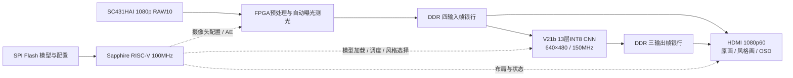

# StyleCam 项目阶段汇报：赛题要求、完成情况与当前问题

日期：2026-10-23。对应《全国大学生嵌入式芯片与系统设计竞赛'2026 FPGA赛道选题指南（易灵思）》赛题一，第4—7页。

**汇报基线：2026-10-18 已验收 RISCV11 AE / IN4，V21b / QAT900。本文不计入刚刚进行的 PE6 / 累加位宽资源优化候选。** 新网络与交互扩展仅按各自实际验证阶段报告，不与正式整机指标混用。

## 一、可直接使用的开场陈述

我们围绕“AI赋能的实时绘画——风格化视频渲染系统”，已在 Ti60F225 上打通摄像头采集、图像预处理、DDR多缓冲、轻量神经网络推理和HDMI显示的完整链路。FPGA负责像素处理、卷积、激活和定点实例归一化，片内RISC-V负责摄像头配置、权重加载、任务调度和界面控制，正常演示不依赖电脑逐帧计算。

当前正式版支持梵高、浮世绘、水墨三种风格，网络实际处理分辨率为640×480。三风格分屏短时板测达到29.99～30.01fps，已经超过赛题基础Demo要求的15fps以上；HDMI输出为1080p60。已实现自动曝光、原画与风格画对比、按键和串口切换，并完成Flash固化、独立回读和RESET_N自主启动验证。

当前主要问题是片上资源余量紧、画质仍需优化、真实720p推理尚未完成，以及语音和手机预览尚未完成三板联调。下一步优先补齐长时稳定性与切换验收、创意交互闭环，以及网络结构和标准网络对比材料。

## 二、按赛题原文逐项对照

### 基础要求

| 赛题要求 | 已完成工作 | 当前结论与验证范围 |
|---|---|---|
| MIPI D-PHY RX / CSI-2接入SC431HAI | 摄像头1920×1080 RAW10实时输入，FPGA完成CSI-2接入 | 已有正式整机板测 |
| RAW转RGB，预处理最低640×480@30fps | 原生BGGR、5×5 MHC去马赛克、Gamma、RGB增益、裁剪、2×2平均和水平翻转，输出640×480 | 采集约30fps；网络尺寸为VGA |
| 双缓冲与外部DDR存帧，保证数据流 | 实现四输入银行、三输出银行、帧所有权保护、并发读写与调度 | 已实现；正式版短时采样窗口内无新增运行期跳帧，长期不丢帧仍需补验 |
| 自选轻量网络，3×3或5×5卷积硬件化 | 自设计V21b微型CNN，共13层，含3×3、1×1、深度卷积、残差及PixelShuffle | 已实现，使用INT8权重与定点计算 |
| 激活及BN/IN近似计算硬件化 | 激活/截断、定点IN、统计和系数更新均在FPGA完成 | 数值回归通过；采用校准及跨帧轮换刷新，不表述为每帧全局IN零等待 |
| 通过系统总线访问DDR，流水处理并写回 | DDR读取输入帧，片上行缓存及层间流水传递特征，结果写回DDR | 已实现，降低中间特征DDR搬运 |
| HDMI最低720p60或1080p30 | 输出1920×1080@60Hz，显示原画、风格画和OSD | 已实现；高清显示包含缩放和重复扫描，不能视为1080p神经网络推理 |
| RISC-V C驱动、摄像头初始化、权重部署与调度 | Sapphire RISC-V完成I²C配置、Flash模型加载与CRC校验、加速器控制、中断/状态处理及UI管理 | 正式整机已实现 |
| 原画与风格画对照，按键切全屏 | 支持左右对比、风格全屏、原画全屏；按键及UART控制，OSD显示FPS/风格/状态 | 已实现；本次正式验收的连续采样范围为三风格分屏 |
| VGA基础Demo，屏幕叠加FPS且稳定15fps以上 | 正式版三风格短时实测29.99～30.01fps，网络耗时采样最大33.2ms | 已有达标短时样本；19条读数覆盖34秒板内时间，长时稳定性验收待补齐 |

### 高阶挑战

| 赛题要求 | 当前进展 | 尚需完成 |
|---|---|---|
| 至少2种风格，不重启、不重新配置FPGA切换 | 已实现梵高、浮世绘、水墨3种风格；共享卷积权重，各风格使用不同IN仿射参数，按键/UART选择 | 补齐正式版各布局、实体按键组合及完整切换测试 |
| 风格切换<100ms且不丢帧 | RISCV10同架构历史3次UART请求到HDMI换帧确认为48.536、48.675、52.534ms | 属于历史样本，正式RISCV11未重测；还需切换帧连续性和多轮验收，不能宣布该项已完整通过 |
| 实际处理1280×720@30fps或更高 | 尚未完成；当前实际推理640×480，已使用行流水、DSP及层间特征流动 | 720p像素量为VGA的3倍，需进一步压缩计算并评估带宽、资源及画质 |
| 自设计/剪枝网络，参数量<500KB | 13层微型CNN，11,028个学习参数；部署blob为48,616B，约47.5KiB | 规模目标满足；提交参数表时说明参数精度、配置记录和IN常量的统计口径 |
| 结构图、参数表，与标准网络比较PSNR/SSIM和推理延迟 | 已有结构、导出、整数参考和24图内部教师对比 | 提交版结构图和同协议标准网络对照尚未完整形成；内部教师对照不能代替标准CycleGAN等基线 |
| 语音、手势、Wi-Fi等创意交互 | ESP32手机热点/网页/按钮请求单板通过；VC-02四条命令UART输出单板通过；独立FPGA交互候选完整构建通过 | 语音→ESP32→FPGA动作、FPGA→手机画面完整闭环尚未验收；创意示例无需全部实现 |
| 展示短视频 | 已具备正式版实时演示基础 | 仍需录制注明实际分辨率、帧率、版本和交互功能的展示材料 |

**原文口径：**采集预处理最低640×480@30fps；风格化基础Demo要求在640×480下稳定15fps以上；1280×720@30fps属于高阶处理目标；参数指标原文为“小于500KB”，并非“500K个参数”。

## 三、正式版的架构与部署方式

- 采用FPGA定制的流式CNN加速器；各层专用硬件形成流水，卷积和IN相关处理在板内完成。
- 卷积权重INT8，激活uint8，累加和归一化采用更宽的定点数据；正式版末层PE12，推理域150MHz，控制和DDR用户域100MHz。
- 三风格共享卷积结构和权重，以风格IN参数区分。切换风格不需要重配整片FPGA。
- 模型blob从SPI Flash加载，经RISC-V配置口写入权重/系数存储；中间特征主要在片上行缓存和层间流水流动，DDR负责帧缓存。
- 动态IN通过启动校准和跨帧统计/轮换系数刷新实现，存在相应控制和算术开销。
- 自动曝光由FPGA在Gamma前测光，RISC-V每200ms按需调整摄像头曝光及模拟增益；AWB和手机预览在正式版默认关闭。

## 四、参数规模、资源占用与性能

### 模型规模

| 参数类别 | 数量 |
|---|---:|
| 卷积权重 | 9,384 |
| IN gamma | 816 |
| IN beta | 816 |
| 输出偏置 | 12 |
| 合计学习参数 | **11,028** |

将全部学习参数按FP32统一换算为44,112B，约43.1KiB（仅作统一精度规模换算，不是实际NPZ文件大小）。实际部署blob为48,616B，约47.5KiB，包含4,050条配置记录及头部。片内还存放由模型导出的IN定点常量。训练checkpoint、参考NPZ的容器大小、部署blob、片内RAM占用和整机bitstream必须分别统计；bitstream不等于网络参数文件。

### 最终布局布线结果：RISCV11 AE / IN4

| 资源 | 已用 / 总量 | 占用率 | 剩余 |
|---|---:|---:|---:|
| XLR逻辑单元 | 55,615 / 60,800 | 91.47% | 5,185 |
| RAM10片上存储块 | 243 / 256 | 94.92% | 13 |
| DSP | 145 / 160 | 90.63% | 15 |
| RISC-V链接RAM，含2,048B栈 | 16,080 / 16,384B | 98.14% | 304B |

最终最小setup slack为+0.253ns，hold slack为+0.026ns，17项setup及17项hold关系全部为正。固件二进制为13,746B。这里使用配套最终布线报告，不使用刚刚候选的综合估算。

层次利用率报告估算：整个推理引擎约33,642.5 XLR、150块RAM、141个DSP，其中IN更新约4,432.5 XLR、12块RAM；CPU约3,479 XLR、24块RAM；DDR控制器约5,650.5 XLR、22块RAM；图像预处理约3,986 XLR、11块RAM、4个DSP；显示模块约1,506 XLR、15块RAM。推理引擎包含网络和IN更新，父子模块不能重复相加，层次XLR估算也不代替整机最终值。

### 性能与验收

| 项目 | 已有结果 | 使用边界 |
|---|---|---|
| 实际CNN处理尺寸 | 640×480 | 不是720p或1080p推理 |
| 正式版处理帧率 | 29.99～30.01fps | 三风格分屏，34秒板内时间、19条串口读数 |
| 网络耗时 | 样本最大33.2ms | 包含板端实际DDR/显示争用，不等同整条摄像头到屏幕时延 |
| 正式版完整VGA离线仿真 | 30.45495ms，307,200像素与参考一致 | 包含动态IN更新与反压，不包含真实DDR/HDMI |
| 运行期新增skip | 采样窗口内为0 | 启动累计skip非零，不能说从开机起从未跳帧 |
| 采集/显示/欠流/IRQ/AE I²C错误 | 采样窗口内均为0 | 尚非长时压力结论 |
| HDMI扫描 | 1920×1080@60Hz | 缩放、重复扫描，不代表每秒60张新风格结果 |
| 固化与自主启动 | Flash写入、独立逐字节回读、实体RESET_N后自主启动通过 | 物理断电重启尚未验收 |

已有离线评估采用24张留出RGB图、640×480，对比指定FP32艺术教师。INT8对该教师的PSNR/SSIM分别为：梵高25.14dB/0.8851、浮世绘27.20dB/0.8867、水墨26.29dB/0.8901。它们表示对特定教师的接近程度，不是艺术效果得分、原照片重建指标或标准CycleGAN对照，赛题也未给出统一绝对及格线。

## 五、目前遇到的问题

| 问题 | 原因与影响 | 后续处理 |
|---|---|---|
| 参数很小，整机资源仍接近上限 | 参数量只描述权重/仿射等数值；实时流水还需要并行乘加、宽权重读取、行缓存、IN统计与更新、CPU、DDR、MIPI和HDMI。9,384B卷积INT8数值也会因各层带宽和RAM宽深配置占据较多块RAM | 按最终层次资源报告优化缓存、存储布局及硬件复用，同时核算时序和帧率，不把文件字节数等同片上利用率 |
| 30fps吞吐余量小 | 30fps约33.33ms/帧，实机样本已到33.2ms；新增争用、布局或交互可能吃掉余量 | 补齐各布局和长时并发测试，记录处理新帧、run_skip、错误和最坏耗时 |
| 实际720p@30fps未实现 | 720p像素数为VGA的3倍；同结构下卷积量约从0.339GMAC/帧升至1.017GMAC/帧，30fps约需30.52GMAC/s，仅为计算量估计 | 需要网络计算压缩、流水/带宽优化及画质对照；不能靠调整HDMI时序完成 |
| 画面风格质量仍需改善 | 已有三风格演示，但部分场景存在偏色、细碎纹理或风格表达不足；离线静态画面不能保证动态摄像头效果 | 固定人脸、室内、风景、亮暗和运动场景比较；兼顾内容保持、笔触、配色及视频稳定性 |
| 新网络尚未完成正式板端验收 | 10月22日FWP1已完成4场景×3风格的新旧离线对照，只改梵高IN gamma/beta，卷积权重与拓扑未变；梵高颜色有有限改善，部分纹理变软 | 作为离线进展汇报，不能沿用旧版30fps；最近一次JTAG枚举未识别下载器，需恢复连接后再按后续安排验证 |
| 语音与手机功能没有形成整机闭环 | ESP32网页/按钮和VC-02命令输出分别已通过单板；三板联调和手机真实预览帧率未验收，VC-02播音仍无声 | 先验证语音→ESP32→FPGA控制，再验证FPGA→ESP32→手机画面和与CNN并发 |
| 固件扩展空间紧 | 当前16KiB链接RAM仅余304B，包含已预留2KiB栈，新增交互/日志可能超限 | 控制常驻数据和日志开销，扩展存储前评估对应片上RAM代价 |
| 验收与比赛材料仍有缺口 | 未补齐正式版切换<100ms、切换帧连续性、长时稳定性、物理断电、标准网络同协议对比，以及完整展示视频 | 用配套位流/模型哈希建立固定验收表，逐项完成并保留日志和视频 |

低功耗是赛题背景目标，当前没有整机功耗实测数据，不报告未经测量的瓦数或能效提升。

## 六、扩展工作应如何汇报

| 工作 | 已完成到哪一步 | 不能扩大成的结论 |
|---|---|---|
| 10月22日D1B60/FWP1新模型 | 固定交付校验、新旧参数核对、四场景三风格共24次CPU整数参考推理；其他两风格8例逐像素不变 | 不是新版已上板，也不是新版已实测30fps |
| 较大V5网络探索 | 历史独立R14候选已上板，320×240实际处理约0.85～0.95fps，识别出大核/高分辨率特征及通用执行器瓶颈 | 尚不满足实时目标，未替换正式版，参数小于500KB不保证实时运行 |
| ESP32-S3单板 | 启动、16MB Flash/8MB OPI PSRAM、热点、网页与按钮请求已验证 | 尚未证明手机能看到实时FPGA风格画面 |
| VC-02单板 | 项目词条固件已烧录，四条指令各实测一次，共20字节UART内容正确 | 不是识别率/抗噪测试；不是已控制FPGA；语音播音未通过 |
| 子卡交互FPGA候选 | 独立完成综合、布局布线、位流和7项预览仿真；资源56,227 XLR、244 RAM10、145 DSP，setup/hold为+0.355/+0.026ns | 仅作为候选构建成果，不能替换正式版55,615/243/145的资源或声称三板验收已通过 |

本表独立交互候选早于本次PE6试验；列出它仅说明创意功能开发阶段，不计入正式整机资源汇总。

## 七、下一阶段优先级

1. **先固化已有演示证据：**三风格、三布局、按键/UART、明暗/运动场景、长时运行、RESET_N和物理断电启动；保留连续处理帧、采集帧、skip、错误及切换时间。
2. **完成一个创意交互闭环：**优先语音切风格和切布局；再做手机预览，并验证开启后主链路的帧率及稳定性。
3. **完善画质与网络对比：**明确教师与标准基线、数据集和尺寸，输出结构图、参数/精度表、MAC、PSNR/SSIM、延迟和板端画面。
4. **在性能约束下推进优化：**逐项记录资源、时序、吞吐和画质。实际720p处理作为进一步挑战，单独安排，不把它当作基础Demo未完成的同义表述。
5. **整理提交材料：**演示视频、系统框图、源码/固件/位流/模型配套清单和可复现实验记录。工程内容已经统一至`C:/Users/lingye/Desktop/FPGA`；远端分支是否合并不等于本地功能是否验收。

## 八、证据索引

- [赛题原文，第4—7页](../../全国大学生嵌入式芯片与系统设计竞赛'2026FPGA赛道选题指南-易灵思.pdf)
- [正式版资源、时序与文件清单](../../FPGAProjects/烧录文件/20261018_RISCV11_Main_AE_IN4_Release/manifest.json)
- [正式版层次资源报告](../../FPGAProjects/烧录文件/20261018_RISCV11_Main_AE_IN4_Release/hier_util.rpt)
- [正式版板测摘要](../../FPGAProjects/烧录文件/20261018_RISCV11_Main_AE_IN4_Release/board_acceptance_20261018.json)
- [正式版固化与自主启动记录](../../FPGAProjects/docs/RISCV11固化与总工程集成_20261018.md)
- [RISCV10历史切换延迟与30fps来源](../../FPGAProjects/docs/资源复核与30fps来源_20261015.md)
- [24图内部教师对照原始结果](../../FPGAProjects/StyleCam/audits/v21b_ukiyoe_qat900_soft15_paired24/summary.json)
- [FWP1离线评估与部署范围](../../FPGAProjects/StyleCam_camera/experiments/v21b_fwp1_20261023/README.md)
- [V5板测结论](../../FPGAProjects/docs/V5上板结论与网络轻量化建议_20261019.md)
- [ESP32单板验收](../../FPGAProjects/StyleCam_camera/validation/esp32_standalone_20261020/run_1792464105683/board_validation.json)
- [VC-02四条命令单板验收](../../FPGAProjects/烧录文件/20261021_ESP32_VC02_J7_Integration/voice/单板验收_20261023.md)
- [子卡交互候选构建与待联调项目](../../FPGAProjects/烧录文件/20261021_ESP32_VC02_J7_Integration/README.md)

本次只核对原文和既有证据、整理汇报稿；没有重新跑板测，也没有下载或烧录。

原始赛题PDF属于本地参考资料，未随Git上传；其本地链接需在完整工作区打开。其他已发布证据使用仓库内相对链接。
