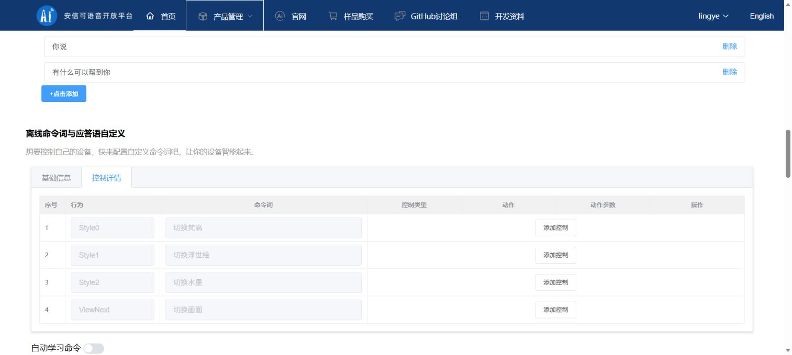

# 控制详情空白的历史排查与重新生成方法

**2026-10-23：版本20261023001已生成并下载，项目更新bin及独立工具目录已准备。当前依据为 [下载产物核对](generated_sdk_verification_20261023.json)，下一步见 [语音板烧录](../下一步_语音板烧录.md)。2026-10-22网页核对记录仅为历史草稿，后续该草稿曾遇到HTTP500并丢失。以下内容仅用于以后重新生成时参考。**

这次已在新标签页验证：**基础信息四行、控制详情四行，行为与命令词全部对应正确**。原先的草稿页未清空、未刷新，三条已有UART控制仍保留。

原页面控制台反复报告 `TypeError: Cannot read properties of undefined (reading 'params')`，发生于命令输入处理 `tx_add`。这说明页面脚本发生异常；“只能三条”不能作为模块或平台的条数限制判断。异常的具体触发原因尚未确定。

## 已验证成功的方法

1. 保留未提交草稿；从 [平台首页](https://voice.ai-thinker.com/#/) → 产品管理 → 产品列表 → **StyleCam语音控制** → 查看详情 → 语音SDK → 点击创建进入编辑器。编辑现有版本则使用该版本的“编辑”。产品上下文需保留，应通过产品入口进入编辑器。
2. 若从头复现，等新页显示默认 `TurnOn` 台灯示例，在“基础信息”中点**这一行右侧的“删除”**。不要用本次已出现残留问题的“清空”按钮。
3. 点击“批量导入”，把 [平台批量导入.txt](平台批量导入.txt) 四行一次性粘贴进去：

```text
Style0=切换梵高@一
Style1=切换浮世绘@二
Style2=切换水墨@三
ViewNext=切换画面@四
```

4. 点一次“确定”。批量导入会追加命令，不要重复提交同一批内容。
5. 基础信息为四条用户命令；控制详情逐一按**行为名**核对Style0、Style1、Style2、ViewNext。详情中可另有内置 `wakeup_uni` 唤醒行，五行也正常；唤醒行保留但不添加UART输出。排除重复用户命令和空白名称，不能按行号填HEX。

本次对“清空后重新导入”的试验出现基础四行、详情五行且重复Style0，因此没有采用该流程。成功的流程是重新加载新页、删除默认示例一行、一次导入四条。



## 新页继续配置前必须补回的项目

**新页不会继承旧页未提交的引脚、唤醒词和HEX。当前成功验证只覆盖四条命令的关联，还不能直接生成可用固件。**

| 配置项 | 目标 |
|---|---|
| 唤醒词 | 小安小安（新页初始默认是“你好小美”，需改回） |
| Pin 7 / B6 | UART1_RX |
| Pin 8 / B7 | UART1_TX；115200 / 8数据位 / 无校验 / 1停止位 |
| GPIO_A28 | 保持默认低电平 |
| B2/B3 | 保持GPIO默认低电平 |
| 音频前端 | 单MIC、远场1–5m、AEC关闭、稳态降噪关闭 |
| 自动学习 / 灵敏度 / 免唤醒 | 关闭 / 中 / 不选任何命令 |

在四条**有名称**的命令行中分别点“添加控制”，控制类型选 `UART1_TX`、动作选“发送”，参数如下：

| 行为 | 命令词 | 参数 |
|---|---|---|
| Style0 | 切换梵高 | `A1 00 01 01 FF` |
| Style1 | 切换浮世绘 | `A1 00 02 01 FF` |
| Style2 | 切换水墨 | `A1 00 03 01 FF` |
| ViewNext | 切换画面 | `A1 00 04 01 FF` |

**参数每两位一组，组间半角空格；当前表单明确不接受连写。** 不加引号、`0x`或回车换行，不给同一条命令添加多条重复发送控制。

全部核对后才点击“生成新版本”。当前20261023001版本已生成并取得项目 `uni_app_release_update.bin`，下载内容核对通过；仍未烧录任何板卡。后续烧录步骤见上一级《下一步_语音板烧录.md》。

