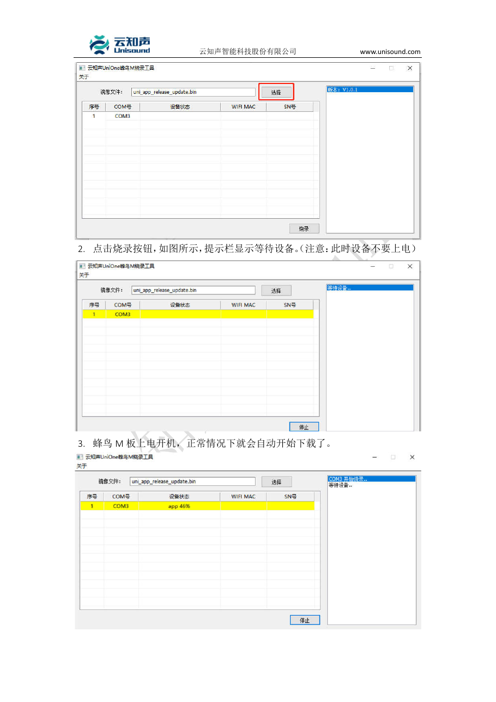

# ESP32 + VC-02 + Ti60F225 V4：从语音配置到三板联调

适用现有 ESP32-S3-N16R8、VC-02-Kit/B207 和 Ti60F225 V4。更新：2026-10-23。

电脑端已准备 ESP32 的 DIO 固件、语音填写清单、工具、离线检查和 JTAG/RAM 下载脚本。
FPGA 完整候选已成功：最终 setup +0.355ns、hold +0.026ns，预览已开启；下载前仍先执行第一步离线检查。
VC-02 版本20261023001已在你的账号生成并下载，本包的 `voice/uni_app_release_update.bin` 已核对唤醒词、四条命令、回复、UART参数和生成代码。独立更新工具目录已准备，先看 [下一步：语音板烧录](下一步_语音板烧录.md)。
2026-10-23语音板已由用户手动烧录，四条语音命令的模块串口输出实测通过，见 [单板验收](voice/单板验收_20261023.md)。本轮尚未烧录ESP32或FPGA；后续涉及这两块板的步骤仍待实物联调。

## 一、先认识这个文件夹

| 文件/目录 | 用途 |
|---|---|
| `fpga/` | 新引脚、预览候选；完整构建通过后才有 manifest 和可下载 bit |
| `esp32/` | 已在这块实物验证过的 DIO / usb_uart 固件及校验/下载脚本 |
| `voice/平台填写内容.txt` | 能直接复制到语音平台的中文词条与 HEX |
| `voice/voice_commands.csv` | 四条语音命令表，不是平台导入文件，也不是固件 |
| `program_fpga_ram.ps1` | 下载 FPGA 易失配置 RAM，不写配置 Flash 或模型 Flash |
| `prepare_voice_update.ps1` | 下载语音bin后，准备独立ASCII路径的工具和项目固件；不会烧录 |
| `list_ports.ps1` | 列出 Windows 串口设备，不打开串口 |

所有后续 PowerShell 命令先在这个目录执行：

```powershell
Set-Location -LiteralPath 'C:\Users\lingye\Desktop\FPGA创新赛\FPGAProjects\烧录文件\20261021_ESP32_VC02_J7_Integration'
```

先做文件检查，不需要插板：

```powershell
.\esp32\flash_esp32.ps1 -Variant usb_uart -CheckOnly
.\program_fpga_ram.ps1 -CheckOnly
```

两项都应输出 PASS/校验成功。FPGA 如果提示尚无完成的 manifest，表示完整构建还未通过，不执行后面的 FPGA 下载。
如果 Windows 仅因脚本执行策略阻止运行，可在当前 PowerShell 窗口执行 `Set-ExecutionPolicy -Scope Process Bypass`，关闭窗口即失效；不用修改整机永久策略。

## 二、语音平台：生成项目固件

2026-10-23：产品“StyleCam语音控制”的纯离线VC-02版本20261023001已生成，两个下载包均已备份，项目更新bin已放入voice目录。本节作为以后重新生成版本时的参考，现在可以直接进入第三节。核对依据见 [下载产物记录](voice/generated_sdk_verification_20261023.json)。

### 2.1 登录与新建产品

1. 用电脑浏览器打开 <https://voice.ai-thinker.com/>，自己完成注册/登录与验证码，不需要把密码发给我。
2. 在产品列表选择“创建产品/新建产品”。产品名可填 **StyleCam语音控制**，型号选 **VC-02**，识别语言选中文。
3. 进入 SDK 定制或产品配置。以下字段名称来自厂家教程，当前界面布局可能调整，以同含义字段为准。

### 2.2 引脚、串口与唤醒词

| 配置项 | 要填的内容 |
|---|---|
| UART | UART1，只启用这一组用户串口 |
| 波特率 | 115200 |
| 数据位/校验/停止位/流控 | 8 / None / 1 / None |
| Kit 对应 TX | B7 = UART1_TX，实物排针叫 TX1 |
| Kit 对应 RX | B6 = UART1_RX，实物排针叫 RX1 |
| A28（页面有此项时） | 保持 GPIO 输出低电平 |
| 唤醒词 | 小安小安 |
| 唤醒回复 | 当前生成版本为“我在 / 你说 / 有什么可以帮到你”随机选一条 |

不要再把 B2/B3 配成另一组 UART1。B6/B7 以 Kit 原理图和厂家平台教程为依据；裸模组新规格表存在反写差异，不据裸焊盘位置数排针。
前端音频参数初次沿用平台的 VC-02 默认配置；暂不增加免唤醒命令。

### 2.3 逐条添加四个命令

每个命令打开“控制详情”，选择 **UART1/串口输出、HEX/十六进制**，填下面的字节。
按当前截图，回复语依次为“一、二、三、四”。语音回复只表示模块识别到命令；FPGA是否执行需看实际画面或日志。

| 命令词 | 参数（每两位一组、组间半角空格） | ESP32 转发字符 |
|---|---|---|
| 切换梵高 | `A1 00 01 01 FF` | `0` |
| 切换浮世绘 | `A1 00 02 01 FF` | `1` |
| 切换水墨 | `A1 00 03 01 FF` | `2` |
| 切换画面 | `A1 00 04 01 FF` | `v` |

发送的是 **5个原始字节**。不要选择字符串模式，不加 `0x`、引号、回车换行或额外校验字节。
如果平台提供自动包头/包尾、校验设置，确保最终实际发出的完整数据就是表内5字节。

### 2.4 生成与保存

保存配置，点击“生成新版本/生成固件”，等当前版本生成成功后下载固件压缩包。
在解压内容中找到 **`uni_app_release_update.bin`**，放到本目录的 `voice/` 文件夹。

当前版本已经完成这些步骤，文件1217688字节，SHA256前12位 `57fd62fc868b`。四条用户命令之外，平台可能显示内置 `wakeup_uni` 唤醒行；该行保留但不添加UART发送。按行为名配置四条发送，不能按行号套数据。

`uni_app_release.bin` 是另一种完整烧录镜像，不能改名充当 `_update.bin`。
更新工具目录里也有一个同名默认文件，必须通过“选择”按钮指向你这次生成的项目文件。
如果下载只有 SDK 或普通完整 bin，先检查平台是否提供串口更新包；不要随意挑一个 bin。

## 三、你做：给 VC-02 更新语音词条

### 3.1 先只接语音板，识别 COM 口

1. 先不接板间杜邦线。关闭串口监视器，暂时拔掉 ESP32 和 FPGA 的电脑 USB，语音板单独用数据 USB 线接电脑。
2. 按 `Win+X` →“设备管理器”→“端口(COM和LPT)”。插拔语音板对照新增/消失的设备，记下它的 COM 号；标准 Kit 常见名称为 USB-SERIAL CH340。
3. 若已经正常显示 COM，不安装驱动。若有黄色叹号或没有串口，用已经解压的 CH341SER.EXE 安装 CH340 对应驱动，再重新插拔。

已经解压好的驱动程序（本次只解压，未安装）：

`C:\Users\lingye\Desktop\FPGA\FPGAProjects\tools\vc02\drivers\Serial_driver_windos\CH341SER.EXE`

### 3.2 先用准备脚本隔离项目固件

在教程目录执行：

```powershell
.\prepare_voice_update.ps1
```

脚本会把你的项目bin、更新工具及DLL放到 `C:\Users\lingye\Desktop\FPGA\FPGAProjects\tools\vc02\stylecam_update_文件哈希前12位\`，并打印完整路径。
双击这个新目录里的 `UniOneUpdateTool.exe`。不要单独移动exe，它依赖同目录DLL。
脚本不打开串口、不烧录；若还没有项目bin，或误用了原工具附带的默认bin，会直接报错。
这里的文件名、大小和SHA检查不等于词条验收，词条仍要按第四节实际说话检查。

### 3.3 选对项目 bin，再让模块重新启动

1. 点击更新工具的 **“选择”**，指向准备脚本打印的新目录里的 `uni_app_release_update.bin`，核对路径。
2. 只连接语音板的串口；如果列表还有其他设备，先核对并断开其他串口设备。这个工具能同时显示多个端口。
3. **当前实物复位键标为RESET：USB保持插着，按住RESET，点击“烧录”；提示“等待设备”后松开RESET，让语音模块启动。**
4. 等进度增加，直到该行变绿并显示“下载完成”，再点击“停止”、关闭工具。
5. 模块重启后说“小安小安”，约1秒后直接说命令，按串口5字节验收；有外接合适扬声器时，再单独检查回复播音。

此前KEY1/KEY2名称来自Kit参考原理图；当前用户实物报告按键为RESET和IOA20唤醒，已通过RESET完成烧录。本版本未配置出厂按键、指示灯和台灯控制逻辑，按键及灯的表现不能作为识别验收依据。
没有可用复位键的版本，需按其厂家方法在工具等待期间重新上电；拔插 USB 后工具能否及时重新识别端口，尚未在这块语音板实测。

厂家工具界面示例：



如果一直等待设备：先查是否选对 COM、是否被其他软件占用、是否完成模块复位、是否确实使用数据线。
厂家旧版说明要求模块原固件支持串口更新。如果确认上述都正确仍无法进入更新，应找语音板卖家确认出厂固件是否已支持更新；当前不要仅因此先购买额外下载器。

## 四、你做：先验收 VC-02 → ESP32，不接 FPGA 信号线

断电接好下面两根线，再分别 USB 供电：

| VC-02 | ESP32 |
|---|---|
| TX1 | GPIO16 |
| GND | GND |

ESP32 用板上标 **COM** 的 USB 接口；当前验证版本是 DIO / usb_uart。
ESP32 GPIO17、GPIO18 暂时不接 FPGA。两板 5V/VCC/3V3 不互接。

1. 手机连接 WiFi **StyleCam**，密码 **stylecam1234**，提示无互联网时选择继续保持连接。
2. 浏览器打开 <http://192.168.4.1/>，找到 Voice module/语音面板，启用抓字节；也可以打开 <http://192.168.4.1/voice> 查看数据。
3. 说“小安小安”，约1秒后直接说“切换梵高”，等片刻刷新语音数据；不以听到回复或灯亮为前提。
4. 应出现 **`A1 00 01 01 FF`**。用串口日志观察时，应命中 `[voice] ... -> console '0'`，随后有发命令日志。
5. 把其余三条也各说一次，逐一对应第二节表格。

若要看 ESP32 115200 串口日志，可在 PowerShell 中用现成工具（`COMxx` 改成 ESP32 当前端口）：

```powershell
& 'C:\Users\lingye\Desktop\FPGA\FPGAProjects\tools\esp32\bin\arduino-cli.exe' --config-file 'C:\Users\lingye\Desktop\FPGA\FPGAProjects\tools\esp32\arduino-cli.json' monitor --port COMxx --config baudrate=115200
```

按 Ctrl+C 退出监视器后再烧录。不要同时由两个程序打开同一 COM。

判断结果：

- 只有欢迎语、`bursts` 始终不增加：查 TX1→GPIO16、共地、波特率及 UART1 引脚设置。
- 收到 `5A ...`、显示 unmatched：多半仍是出厂词条固件；本项目期望 `A1 ...`，先核对是否真的烧入新版本。
- 收到 `41 31 20 ...`：把“ A1 ... ”当文字发送了，返回平台改 HEX 原始字节模式。
- 收到正确 A1 帧并命中：语音板到 ESP32 已通过，此时还没有证明 FPGA 执行。

## 五、你做：确认子卡、下载 FPGA 候选到 RAM

本教程针号适用于 **Ti60F225 V4 的 QSE 转 2.54mm 双排40针、同编号直通子卡**。
你的淘宝商品详情之前无法读取；子卡实物没有核验。请先确认子卡连接关系：主板 J7-37 对应排针 J28-37，J7-39 对应 J28-39，J28-35/36 为 GND。
若针数、板号、转接关系不同，先提供正反面清晰照片和规格，不能仅凭“转接板”三个字套用本表。

确认后，先让子卡信号线留空，保持 FPGA 原来的电源、摄像头、HDMI 和 JTAG/日志 USB 接法。
在本教程目录执行：

```powershell
.\program_fpga_ram.ps1 -CheckOnly
```

通过后，下面这条才会真正下载 FPGA 配置 RAM：

```powershell
.\program_fpga_ram.ps1
```

它不写配置 Flash 和 0x200000 模型区。下载日志为 `fpga_ram_program.log`，JTAG 工具成功并不等于三板功能已验收。
候选仍使用 R11 的 FPGA ID `53430a0b`，不能只凭这个 ID 区分它与正式版；还要核对本包 manifest、下载日志和后续预览。

观察原 HDMI 摄像头画面、三风格和自动曝光是否正常；板载 UART 的 FPGA 日志输出保留。
新映射把控制输入移到了子卡，电脑 FTDI 的 TX 已不能控制 CPU；串口监视器此时主要用于读日志。

## 六、你做：接控制线，先用网页按钮确认 FPGA 执行

核对第五节候选下载成功后，断电补接：

| 起点 | 终点 |
|---|---|
| ESP32 GPIO17 | 子卡 J28-37 |
| 子卡 J28-35或36，任选一个 GND | ESP32 另一处 GND |

保持第四节的语音 TX1→GPIO16 和 GND 连接，GPIO18 仍暂不接。
重新供电并再次按第五节下载 RAM 候选，因为 FPGA 断电会丢失刚才的临时 RAM 配置。

1. 手机网页点梵高、浮世绘、水墨按钮。
2. 必须看到 FPGA 的 HDMI 画面/风格状态实际变化；ESP32 网页命令数增加，只表示它发出了命令。
3. 网页控制通过后，再说“小安小安”→“切换水墨”，检查 FPGA 也实际切换。
4. 再说“切换画面”，确认 FPGA 的布局实际改变。

若网页计数增加但 FPGA 不动：查 RAM 候选是否因断电回退、GPIO17→J28-37、共地及 FPGA 是否已 ready。
控制链路参数为 115200、8N1。

## 七、你做：接预览线，检查手机画面

断电补接最后一根信号线：**子卡 J28-39 → ESP32 GPIO18**，然后供电并重新下载 RAM 候选。
最终共5根板间杜邦线：语音TX、控制TX、预览TX、语音共地、FPGA共地；都约10cm。
各板仍分别供电，板间 VCC/5V/3V3 不互接。麦克风和喇叭接语音板原配接口，SPK−不接GND。

手机重新打开网页，预览计数应持续增加，并显示 FPGA 输出画面的缩略预览。
本候选采样为 **96×54 RGB332**，UART 为 **3030303、8N1**；它是预览，不是 HDMI 原分辨率视频。
检查 CRC/同步错误是否持续增长。如果有大量错误，先缩短线、让地线靠近信号线，再检查接地、供电和参数。
0帧时依次查：RAM 候选是否重新下载、J28-39→GPIO18、共地、FPGA 是否正常显示，以及是否加载了本次启用预览的包。

只接现有正式 FPGA 程序时，预览默认关闭，0帧不能据此判断 ESP32 损坏。

## 八、需要恢复时

本次脚本只写 FPGA RAM，原正式配置和模型 Flash 不被改写。断电后 FPGA 会重新按原 Flash 配置启动；如果要继续联调，要再次下载本候选。
也可用原正式包的 `.bit` 通过原 JTAG/RAM 脚本恢复。原包是本目录相邻的 `20261018_RISCV11_Main_AE_IN4_Release`。
若需要恢复原电脑串口控制方式，先断电拆掉 ESP32→J28-37 控制线，并恢复原正式 FPGA 配置。

ESP32 已能连热点和打开网页时，不需要为了接子卡重新烧录。
只有确需恢复本包 ESP32 固件时，先断开它与其余板的信号线，在本目录执行（`COMxx` 换成 ESP32 的端口）：

```powershell
.\esp32\flash_esp32.ps1 -Variant usb_uart -Port COMxx -ToolRoot 'C:\Users\lingye\Desktop\FPGA\FPGAProjects\tools\esp32'
```

该 ESP32 操作会覆盖16MB Flash，与前面的 FPGA RAM 下载是两件不同的事；保留需要的旧 ESP32 程序后再执行。

## 依据与实测边界

- [安信可 VC 官方资料入口](https://docs.ai-thinker.com/vc/)及其链接的[官方平台教程](https://blog.csdn.net/Boantong_/article/details/124689101)、[官方串口烧录教程](https://blog.csdn.net/Boantong_/article/details/123846788)。
- 本机工具随附的 `USB_Update_Tool_User_Guide.pdf`，已检查完整相关页；图片来自其中第3页。
- VC-01/02-Kit 原理图，KEY1/RST→Q1模块供电门控，CH340电源保持。
- ESP32 原有板测记录证明 DIO 启动、PSRAM、手机热点/网页/按钮请求；本轮不重复声称完成语音 UART 或 FPGA 实物验收。
- FPGA 候选离线结果以 `fpga/manifest.json` 为准；离线通过仍需按本教程逐项实物验收。
