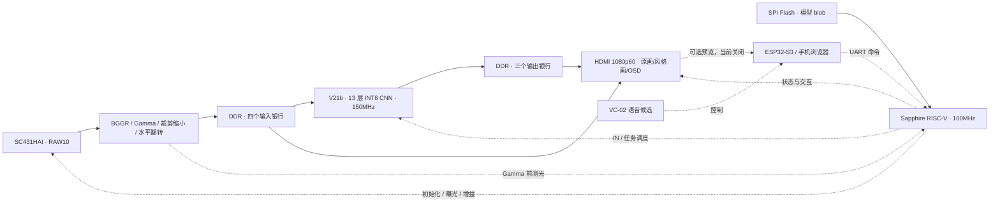

# StyleCam：基于 Ti60F225 的实时 AI 绘画系统

StyleCam 将 **SC431HAI 摄像头**拍摄的实时画面转换为梵高、浮世绘、水墨三种艺术风格，并通过 HDMI 展示原画与风格画。图像采集、颜色处理、INT8 神经网络推理和视频输出在 Ti60F225 FPGA 上完成；片内 Sapphire RISC-V 负责摄像头初始化、自动曝光、模型装载、任务调度、按键交互与 OSD 管理。正常演示无需电脑参与逐帧处理。

项目面向 2026 年全国大学生嵌入式芯片与系统设计竞赛 FPGA 赛道易灵思赛题一，重点是打通摄像头到显示器的完整实时链路，在有限 FPGA 资源内兼顾画面、帧率和交互。

> **当前正式版 · 2026-10-18：RISCV11 AE / IN4，ID `53430a0b`。**
>
> 用户已确认自动曝光和三风格画面正常。同一 BIT 重新下载后三风格短时采样为 **29.99～30.01fps**，窗口内无新增运行期跳帧，采集、显示及 AE I²C 错误为 0。已写入 Flash、独立逐字节回读，并在用户按 **RESET_N** 后捕获完整自主启动。物理断电重启、全部布局与长时间压力测试尚未验收。
>
> 下载包：[20261018_RISCV11_Main_AE_IN4_Release](FPGAProjects/烧录文件/20261018_RISCV11_Main_AE_IN4_Release/README.md)。当前原 V21b 网络启用自动曝光，手机预览与自动白平衡默认关闭；队友的新网络和手势扩展保留在各自交付/分支，尚未切入本版。固化和清理证据见[集成记录](FPGAProjects/docs/RISCV11固化与总工程集成_20261018.md)。

## 项目功能与架构

- **实时摄像头输入**：接入 SC431HAI 的 MIPI CSI-2 / RAW10 数据，完成原生 BGGR 去马赛克、Gamma、颜色增益、裁剪缩小及 RGB 水平翻转。
- **三风格 FPGA 推理**：运行 V21b 的 13 层轻量 INT8 CNN，使用共享卷积权重和各风格 IN 参数，无需重新配置 FPGA 即可切换风格。
- **HDMI 对比展示**：支持左原画右风格、风格全屏、原画全屏三种布局；OSD 显示 FPS、风格、网络耗时和摄像头状态。
- **自动曝光**：在 Gamma 前统计亮度，RISC-V 每 200ms 按需调节 SC431HAI 曝光和模拟增益；复用 APB / I²C，保持摄像头帧周期。目标亮度 64、死区 56～72；AWB 关闭。
- **独立运行**：开机从 SPI Flash 读取并校验模型，初始化三个风格并连续调度；电脑只用于下载或调试。
- **创意交互候选**：保留 VC-02 语音、ESP32-S3 控制桥和 96×54 RGB332 手机预览源码。该扩展仍需原生工具链构建、接线和实机并发验证。



中间特征通过片上行缓存和层间流水传递，DDR 用于输入帧、结果帧及显示缓冲。控制与 DDR 用户域为 100MHz，推理域为 150MHz，末层采用 PE12；输入、输出银行和帧所有权保护用于减少计算等待与运行期跳帧。

## 分辨率、性能与验证范围

| 环节 | 配置 / 结果 | 证据范围 |
|---|---|---|
| 摄像头输入 | 1920×1080 RAW10，约 30fps | SC431HAI 实时采集 |
| 网络实际处理 | **640×480，29.99～30.01fps** | 本版三风格、分屏；19 个串口读数覆盖 34 秒板内时间 |
| HDMI 输出 | **1920×1080，60Hz 扫描** | 显示缩放和重复扫描，不等于 1080p 网络推理 |
| 网络耗时 | 本版采样最高 33.2ms | 包含实际 DDR / 显示争用 |
| 完整 VGA 离线仿真 | 单帧 30.45495ms，307200 像素与参考相同 | 包含 IN 更新和流反压，不包含真实 DDR / HDMI |
| 风格切换历史测量 | RISCV10 三次为 48.536 / 48.675 / 52.534ms | UART 请求到 HDMI 换帧确认；本版未重测此项 |
| 手机预览候选 | 96×54 RGB332 | 本版关闭；实际无线帧率待测 |

启动期累计 `skip` 非零，采样窗口内 `run_skip=0`，因此结论是“窗口内无新增运行期跳帧”。三风格长时间运行、其余布局、实体按键延迟和摄像头到显示器的完整时延仍需补验。Flash 配置复位自主启动已通过，物理断电重启尚未验收。

## 网络与数值一致性

本版继续使用 **V21b / QAT900**：固定 C24/Fc16 结构、13 层 CNN、11,028 个参数，模型 blob 为 48,616 字节，单帧 VGA 卷积计算量约 339,148,800 MAC。卷积、激活、定点 IN 和 IN 更新由 FPGA 完成。

第四轮优化修改 `sc_in_alu.v` 和 `sc_in_refresh.v`，复用算术寄存器并无损编码 epsilon 常量；13 层卷积、PE12、模型权重、INT8 精度和 IN 数值规则保持不变。337520 组 ALU、3273 组真实 IN、816 组常量、三风格小图与完整 VGA 逐像素回归通过。

| 编号 | 风格 | UART 命令 |
|---|---|---|
| 0 | 梵高 / Van Gogh | `0` |
| 1 | 浮世绘 / Ukiyo-e | `1` |
| 2 | 水墨 / Ink Wash | `2` |

模型参数量小不代表整机 FPGA 占用小，行缓存、归一化、RISC-V、DDR、摄像头和 HDMI 接口同样消耗资源。训练、量化、导出与历史评估见 [StyleCam 模型目录](FPGAProjects/StyleCam/README.md)。离线 PSNR / SSIM 仅代表指定参考下的结果。

## 当前资源

| 资源 / 时序 | RISCV10 历史基线 | RISCV11 AE / IN4 正式版 | 正式版余量 |
|---|---:|---:|---:|
| XLR | 58284 / 60800 | **55615 / 60800** | **5185** |
| RAM10 | 245 / 256 | **243 / 256** | **13** |
| DSP | 145 / 160 | **145 / 160** | **15** |
| 最小 setup slack | +0.278ns | **+0.253ns** | 全部 17 项关系为正 |
| 最小 hold slack | +0.026ns | **+0.026ns** | 全部 17 项关系为正 |

比第三轮再少 1500 XLR 和 1 RAM10，比早期手机预览开启的交互包少 3325 XLR 和 10 RAM10。固件 13746 字节，链接 RAM 16080/16384 字节（含 2048 字节栈），剩余 304 字节链接空间。资源与时序均来自配套最终布线报告。

## 当前进度与保留分支

| 工作项 / 分支 | 当前状态 |
|---|---|
| 摄像头 → DDR → CNN → HDMI、自动曝光、三风格 | 本版实机通过，已固化并通过 RESET_N 自主启动 |
| `main` 的整机入口 | 本次集成 RISCV11 AE / IN4；独立的新网络交付目录保留，不启用 |
| `codex/release-riscv11-ae-in4-20261018` | 本次正式版源码、下载包与证据 |
| `feat/basic-requirements` | RISCV08 / ID `53430a08` 恢复基线，保留 |
| `codex/resource-throughput-20261013` | RISCV10 / ID `53430a0a` 的固化与短时 30fps 基线，保留 |
| `fw/creative-interaction` / PR #3 | 保留语音、预览及队友手势扩展；最新手势内容未拉取、未并入本版 |
| 新网络交付及 `codex/tristyle-v4-paired-v5-20261018` | 已确认存在，按用户安排逐步试验，保留 |
| 原生 ESP32 构建、创意三板联调 | 待完成 |
| 真实 1280×720@30fps 推理 | 未完成；HDMI 1080p60 不能抵算 |
| 长期稳定性、标准网络对比、展示与提交材料 | 待完善 |

版本以包名、位流哈希和清单共同确定；多个优化包沿用 ID `53430a0b`，不能仅凭 ID 判断同一构建。历史 [PR #4](https://github.com/icy768/ti60f225-AI-drawing/pull/4) 保留 RISCV10 基线讨论；未验证的创意分支继续独立。

## 操作与下载

主链路硬件为 Ti60F225 开发板、SC431HAI 摄像头、DDR3、HDMI 显示器及串口连接。控制台为 **115200 8N1**，本机证据使用 COM19。

| 操作 | 功能 |
|---|---|
| K0 | 循环切换分屏、风格全屏、原画全屏 |
| KEY3 短按释放 / 长按约 0.7 秒 | 切风格 / 切布局 |
| UART `0` / `1` / `2` | 选择风格 |
| UART `v` / `s` / `c` | 切布局 / 状态查询 / 摄像头回读 |
| RESET_N | 重新从配置 Flash 装载整机；与 K0 不同 |

唯一整机 Efinity 入口为 **`FPGAProjects/StyleCam_camera/ti60f225_oob.xml`**。`StyleCam/syn/vision_map.xml` 是算法子系统，`sc431hai_hdmi` 是独立摄像头参考。

```powershell
git clone https://github.com/icy768/ti60f225-AI-drawing.git
cd ti60f225-AI-drawing/FPGAProjects/StyleCam_camera

# 离线核对正式包，不操作硬件
./program_ram.ps1 -CheckOnly
python program_flash_release.py --check-only

# 需要重新下载时，分别选择 RAM 或 Flash
./program_ram.ps1 -UartPort COM19
python program_flash_release.py
# Flash 写入后先开启监听，再按 RESET_N
./verify_flash_boot.ps1 -UartPort COM19 -ConfigurationResetConfirmed
```

Flash 工具先双重备份配置区，保护 0x200000 模型区，写入后独立读取完整配置及模型。具体哈希、验收日志和恢复资料见[正式包](FPGAProjects/烧录文件/20261018_RISCV11_Main_AE_IN4_Release/README.md)。RISCV10 工具保留为 `program_riscv10_ram.ps1`、`program_riscv10_flash.py`、`verify_riscv10_flash_boot.ps1`，配合原分支与包使用；RISCV08 原恢复工具保留。

## 构建、回归与目录

主要工具为 Efinity 2026.1、Python 3、RISC-V GCC 和 Icarus Verilog。`STYLECAM_EFINITY` 指定 Efinity，`STYLECAM_BUILD_DIR` 指定 ASCII 构建镜像。构建入口为 `python build.py interface / map / pnr / pgm`，固件位于 `embedded_sw/soc/software/standalone/stylecam/`。源码或 ROM 变更后须重新构建与验收；当前正式包对应的构建命令、源码哈希与最终报告均已保存。

| 目录 | 内容 |
|---|---|
| [StyleCam_camera](FPGAProjects/StyleCam_camera/README.md) | 整机 RTL、固件、模型、约束及验证脚本 |
| [StyleCam](FPGAProjects/StyleCam/README.md) | 网络训练、导出和历史评估 |
| [烧录文件](FPGAProjects/烧录文件/README.md) | 当前正式版及历史候选 / 恢复包 |
| [集成记录](FPGAProjects/docs/RISCV11固化与总工程集成_20261018.md) | 板测、Flash、资源、清理与验证边界 |
| [协作指南](docs/三人协作指南.md) | 分支协作约定 |

已清理旧资源试验的重复构建镜像和独立摄像头 AE / AWB 原型，完整归档保存在本机 `FPGAProjects/_archive/`。回归源码、当前测试向量、正式包、历史资源对照和恢复资料保留；大型工具与构建缓存不随仓库发布。
