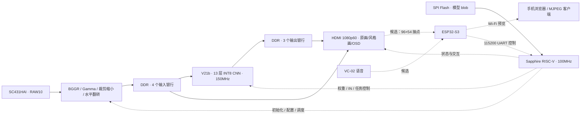

# StyleCam：基于 Ti60F225 的实时 AI 绘画系统

StyleCam 将 **SC431HAI 摄像头**拍摄的实时画面转换为梵高、浮世绘、水墨三种艺术风格，并通过 HDMI 同时展示原画与风格画。图像采集、颜色处理、INT8 神经网络推理和视频输出在 Ti60F225 FPGA 上完成；片内 Sapphire RISC-V 负责摄像头初始化、模型装载、任务调度、按键交互与 OSD 状态管理。正常演示无需电脑参与逐帧图像处理。

本项目面向 2026 年全国大学生嵌入式芯片与系统设计竞赛 FPGA 赛道易灵思赛题一，重点是打通摄像头到显示器的完整实时链路，并在有限 FPGA 资源内兼顾画面、帧率和交互。

> **进度口径 · 2026-10-15**
>
> RISCV10 / V21b 已完成 RAM 下载后的 40 秒实机采样：640×480 风格处理 29.99～30fps，观察窗口内无新增跳帧，三次 UART 切风格到 HDMI 换帧确认最大 52.534ms。语音切风格与 Wi-Fi 手机预览已实现候选并通过代码审查、仿真及 FPGA 编译，**尚未上板验收、尚未合并**。按当前安排，先完成实机验证，再合并分支；所有现有分支保留。

## 项目能做什么

- **实时摄像头输入**：接入 SC431HAI 的 MIPI CSI-2 / RAW10 数据，完成原生 BGGR 去马赛克、颜色处理、裁剪缩小与 RGB 水平翻转。
- **三风格 FPGA 推理**：运行 V21b 的 13 层轻量 INT8 CNN，使用共享卷积权重和各风格 IN 参数，实现无需重新配置 FPGA 的风格切换。
- **HDMI 对比展示**：支持左原画右风格、风格全屏、原画全屏三种布局；OSD 显示 FPS、风格、网络耗时和摄像头状态。
- **RISC-V 整机控制**：通过 APB 控制数据通路，开机从 SPI Flash 装载并校验模型，完成三风格初始化、连续帧调度、中断和 UART 控制。
- **资源与低延迟优化**：将推理域提高到 150MHz，末层采用 PE12，结合输入/输出多银行 DDR 缓冲、跨时钟 FIFO 和帧所有权保护，减少等待与运行期跳帧。
- **创意交互候选**：VC-02 识别语音命令，ESP32-S3 桥接控制指令并提供手机预览网页；附带可选 MJPEG 输出。此项待实机验证。

## 系统架构



图中实线为已打通的主链路，虚线包含控制关系及待上板的交互扩展。中间特征通过片上行缓存和层间流水传递，DDR 用于输入帧、结果帧及显示缓冲；不是把全部中间特征逐层写回外存。

## 分辨率、帧率与时延

摄像头采集、网络处理和 HDMI 扫描是三项不同指标：

| 环节 | 当前配置 / 结果 | 说明 |
|---|---|---|
| 摄像头输入 | 1920×1080 RAW10，约 30fps | SC431HAI 实时采集 |
| 网络实际处理 | **640×480，29.99～30fps** | RISCV10 的 40 秒实机采样结果 |
| HDMI 输出 | **1920×1080，60Hz 扫描** | 显示缩放和重复扫描，不代表 1080p 神经网络推理 |
| 风格切换 | 48.536 / 48.675 / 52.534ms | 三次 UART 请求到 HDMI 换帧确认，不含显示器发光延迟 |
| 网络耗时 | 实机采样约 32.9～33.2ms | 不能用纯计算仿真时间代替实际 DDR 争用结果 |
| 手机预览候选 | 96×54 RGB565 | 从显示光栅抽点；不是高清推流，实际无线帧率待测 |

上述实机证据覆盖分屏布局和短时运行。启动期累计 `skip` 非零，采样窗口内 `run_skip=0`；应表述为“该窗口内无新增跳帧”，不能扩展为所有场景永久不丢帧。三风格长时间运行、其他布局、实体按键延迟及摄像头到屏幕的完整时延仍需补验。

详细日志、位流哈希与验证边界见 [RISCV10 发布说明](https://github.com/icy768/ti60f225-AI-drawing/blob/codex/resource-throughput-20261013/FPGAProjects/烧录文件/20261015_RISCV10_LowLatency_Candidate/README.md)。

## 模型与风格

当前使用 **V21b / QAT900** 候选模型：固定 C24/Fc16 结构、13 层 CNN、11,028 个参数，部署 blob 为 48,616 字节，单帧 VGA 卷积计算量约 339,148,800 MAC。卷积、激活、定点 IN 及 IN 更新由 FPGA 完成。

| 编号 | 风格 | UART 命令 |
|---|---|---|
| 0 | 梵高 / Van Gogh | `0` |
| 1 | 浮世绘 / Ukiyo-e | `1` |
| 2 | 水墨 / Ink Wash | `2` |

模型参数量小不等于整机 FPGA 占用小：图像行缓存、激活数据、归一化、RISC-V、DDR、摄像头和 HDMI 接口同样消耗资源。训练、量化、导出与历史评估见 [StyleCam 模型目录](FPGAProjects/StyleCam/README.md)。现有 PSNR/SSIM 是离线、指定参考图下的结果，不能直接作为屏幕观感、标准网络对比或官方评分。

## 当前进度

| 工作项 | 状态 | 验证范围 / 剩余事项 |
|---|---|---|
| SC431HAI → RGB → DDR → CNN → HDMI | 已实现并有实机记录 | 使用当前 RISC-V 整机链路 |
| 三风格切换、三种显示布局、OSD | 已实现 | UART 切换有定量记录；长时和各操作组合仍需补验 |
| VGA 约 30fps | 短时实机通过 | 40 秒、分屏布局；尚非全场景长期稳定性结论 |
| 模型数值一致性 | 离线回归通过 | 包含完整 VGA 逐像素、IN 算术及跨时钟验证 |
| RISCV10 Flash 固化 / 配置复位启动 | **2026-10-16 验收通过** | 1075167 字节独立回读一致、模型不变、完整自主启动与约30fps运行通过；未单独做完整断电周期 |
| 语音切风格 + 手机预览 | **候选已实现，待上板** | 主机 6 项检查、3 组 RTL 回归、interface/map/pnr/pgm 通过；PR #3 未合并 |
| ESP32 原生工具链构建与三板联调 | **待完成** | 主机桩编译不能代替 ESP32 真机构建和联调 |
| 真实 1280×720@30fps 推理 | **未完成** | 不能用 HDMI 1080p60 抵算 |
| 完整 AE/AWB、标准网络同协议画质/延迟对比 | **待完善** | 当前有手动 RGB 增益；现有内部评估需与正式对比区分 |
| 手势识别、完整展示视频与提交材料 | 手势暂不做；材料待补齐 | 创意示例无需全部实现 |

逐项赛题口径和证据入口见 [当前进度与赛题要求](FPGAProjects/docs/赛题指标与完成情况_20261015.md)。

## 资源占用

两列对应不同源码和构建，不能混用：

| 资源 / 时序 | RISCV10 主链路基线 | RISCV10 + 创意交互候选 |
|---|---:|---:|
| XLR | 58,284 / 60,800 | 58,940 / 60,800 |
| RAM10 | 245 / 256 | 253 / 256 |
| DSP | 145 / 160 | 145 / 160 |
| 最小 setup slack | +0.278ns | +0.288ns |
| 最小 hold slack | +0.026ns | +0.026ns |
| 实机范围 | 已有上述 40 秒记录 | 尚未上板 |

交互候选相对基线增加 656 XLR、8 块 RAM10，未增加 DSP；剩余 1,860 XLR、3 块 RAM10 和 15 个 DSP，当前功能能放下，后续扩展需重新核算。FPGA 编译通过与时序满足不能代替实际接线、串口吞吐、无线预览和语音效果验收。

基线分析见 [RISCV10 资源与吞吐记录](https://github.com/icy768/ti60f225-AI-drawing/blob/codex/resource-throughput-20261013/FPGAProjects/docs/资源复核与30fps来源_20261015.md)；候选的修复、资源原报告和最终时序见 [创意交互审查记录](https://github.com/icy768/ti60f225-AI-drawing/blob/fw/creative-interaction/FPGAProjects/docs/创意交互审查与资源复核_20261015.md)。

## 版本与分支

**项目最新进度不等于默认分支已经包含全部功能。** 目前保留以下分支，先上板验证，再处理合并与清理：

| 分支 | 代码范围 | 使用建议 |
|---|---|---|
| `main` / `develop` | 既有 SCU09 / V21b 主线 | 本轮仅更新项目文档；尚未合入后续 RISC-V / RISCV10 功能 |
| `feat/basic-requirements` | RISCV08，ID `53430a08` | 已固化并验收自主启动的恢复基线 |
| `codex/resource-throughput-20261013` | RISCV10，ID `53430a0a` | 复现已保存的 VGA 约 30fps 主链路实机结果 |
| `fw/creative-interaction` | RISCV10 + 语音 / Wi-Fi 预览候选 | 本次修复已推送；待上板，不作为已验收发布 |

[PR #3](https://github.com/icy768/ti60f225-AI-drawing/pull/3) 为创意交互候选；[PR #4](https://github.com/icy768/ti60f225-AI-drawing/pull/4) 为 RISCV10 基线的待集成记录。二者均暂不合并。位流需与源码、ROM、模型和清单配套，不能仅凭相同 ID 判断是同一构建。

## 硬件与操作

主链路使用 Ti60F225 FPGA 开发板、SC431HAI 摄像头、DDR3、HDMI 显示器和串口调试连接。交互扩展增加 ESP32-S3-N16R8 与 VC-02-Kit。

| 操作 | 功能 |
|---|---|
| K0 | 循环切换分屏、风格全屏、原画全屏 |
| KEY3 短按后释放 | 切换三种风格 |
| KEY3 长按约 0.7 秒 | 切换显示布局 |
| UART `0` / `1` / `2` | 选择风格 |
| UART `v` / `s` / `c` | 切布局 / 状态查询 / 摄像头寄存器回读 |

RISC-V 版本控制台为 **115200 8N1**，串口号以本机实际枚举为准，保存的实机日志使用 COM19。

交互候选中，FPGA `stream_tx` 接 ESP32 GPIO18，视频波特率 3030303；VC-02 的 TX1 接 GPIO16；GPIO17 以 115200 向 FPGA `uart_rx` 发命令。VC-02-Kit 的 **VCC 是 5V 输入，UART IO 为 3.3V，3V3OUT 是输出**，详见 [官方规格书](https://docs.ai-thinker.com/_media/vc-02-kit_specification_v1.0.0_516.pdf)。候选引脚与完整接线说明见 [Wi-Fi / 语音文档](https://github.com/icy768/ti60f225-AI-drawing/blob/fw/creative-interaction/FPGAProjects/StyleCam_camera/wifi_stream/README.md)，上板前须按实际板卡核对排针位置和供电。

## 获取工程与构建

建议按目标选择分支。下面以已保存实机证据的 RISCV10 为例：

```powershell
git clone https://github.com/icy768/ti60f225-AI-drawing.git
cd ti60f225-AI-drawing
git switch codex/resource-throughput-20261013
cd FPGAProjects/StyleCam_camera
```

唯一整机 Efinity 入口是 **`FPGAProjects/StyleCam_camera/ti60f225_oob.xml`**。`StyleCam/syn/vision_map.xml` 是算法子系统入口，`sc431hai_hdmi` 是独立摄像头参考，均不能替代当前整机入口。

主要工具为 Efinity 2026.1、Python 3、RISC-V GCC；RTL 回归使用 Icarus Verilog，ESP32 主机检查使用 g++，实际 ESP32 固件还需对应 Arduino ESP32 工具链。工具二进制和大型构建缓存不随仓库发布。

```powershell
# 仅核对 RISCV10 下载包，不操作硬件
.\program_ram.ps1 -CheckOnly

# FPGA 离线构建；STYLECAM_EFINITY 可指定 Efinity 安装目录
python build.py interface
python build.py map
python build.py pnr
python build.py pgm
```

构建脚本使用 ASCII 路径镜像，以避免工具处理中文路径的问题；可通过 `STYLECAM_BUILD_DIR` 指定构建目录。固件重建、RAM 下载和 Flash 恢复步骤请按所选版本说明执行。本轮仅整理与离线验证，没有新增硬件下载或 Flash 写入。

## 目录导航

| 路径 | 内容 |
|---|---|
| [FPGAProjects/StyleCam_camera](FPGAProjects/StyleCam_camera/README.md) | 整机 RTL、RISC-V 固件、模型 blob、工程约束、构建与验证工具 |
| [FPGAProjects/StyleCam](FPGAProjects/StyleCam/README.md) | 网络训练、量化、导出、整数参考和历史评估证据 |
| [FPGAProjects/sc431hai_hdmi](FPGAProjects/sc431hai_hdmi/README.md) | 独立摄像头与 HDMI 参考工程 |
| [FPGAProjects/烧录文件](FPGAProjects/烧录文件/README.md) | 各版本 BIT/HEX、清单及验收说明；具体文件随分支不同 |
| [FPGAProjects/docs](FPGAProjects/docs/赛题指标与完成情况_20261015.md) | 当前进度、性能口径、资源与历史交接记录 |
| [docs/三人协作指南.md](docs/三人协作指南.md) | 分支职责、代码协作和合并前的验证约定 |

下一步先验证创意交互候选的实际接线、ESP32 原生构建、预览持续传输、语音切换和主链路并发稳定性。验收记录完成后，再合并并清理已经失去独立用途的分支。
