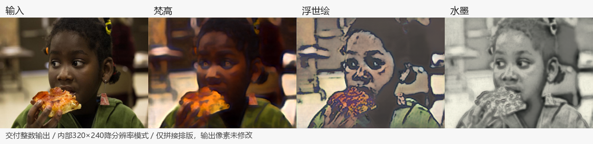
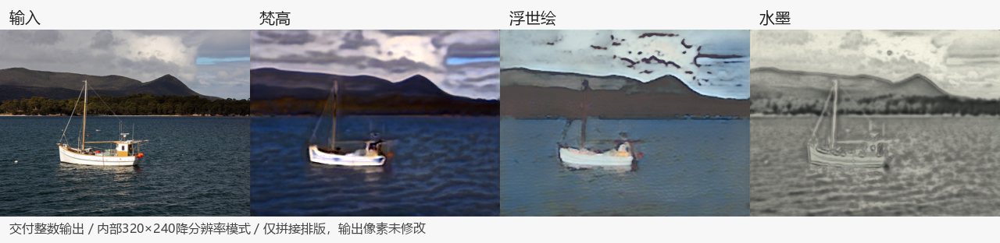
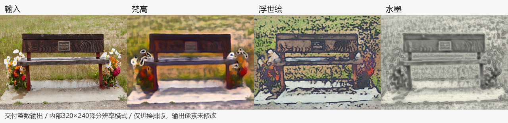

# 三风格统一网络：V4项目配对V5冻结候选

本目录独立保存2026-10-18交付的可推理权重、运行代码、训练源码及图片/视频。原有首版目录保持不变。此版是实验候选，尚未完成艺术质量验收、FPGA整网综合与板测；CPU整数解释器用于功能复现，不代表板端实时性能。

## 推理

进入本目录，使用Python3.10安装依赖，输出目录须不存在：

```powershell
python -m pip install -r requirements.txt
python infer.py --input inputs/person_face.png --output output_integer --backend integer --mode reduced320
python infer.py --input inputs/person_face.png --output output_fp32 --backend fp32 --mode native
```

默认输出三种风格，可用`--style vangogh|ukiyoe|ink`选择。另有`--backend fake|onednn`。便携推理只依赖本目录，不读取原V3工程。

`reduced320`内部320×240，另输出640×480的2倍显示图，是降分辨率模式；非4:3输入会拉伸。`native`保留输入尺寸。完整整数包为495,552字节，网络参数420,993个，INT8权重加INT32偏置442,980字节；三者分别核算，详见[MODEL.json](MODEL.json)。

## 实际输出

每行依次为输入、梵高、浮世绘、水墨；这些预览只拼接交付整数输出，未增强，均为内部320×240模式。






完整17场景、两输入模式、FP32/fake/整数图片在[images](images)；[离线浏览页](INDEX.html)可下载后用浏览器打开。输入图位于[inputs](inputs)。

最终FP32视频在[videos/fp32](videos/fp32)，规范整数输出视频在[videos/integer](videos/integer)：每类含三风格×两模式，共12段；每模式为Sintel640–789的150帧留出视频，只作推理。

## 源码与文件结构

- `models/`：FP32、fake量化状态、oneDNN模型、固定整数包及输入尺度。
- `runtime/`、`infer.py`：网络定义、量化适配与规范整数执行。
- `reproduction_project/`：本轮配对目标生成、训练、诊断和导出源码及配置。
- `provenance/`：QAT/导出配置及当时源码快照，保留历史路径和来源哈希。
- `MANIFEST.json`：本目录逐文件SHA256；不包含自身。

训练源码复现仍需原授权数据、V3初始化权重和记录的目录环境；不包含完整训练集。推理不需要这些外部路径。本次不收录验收说明、验收报告、监督/会话记录或定时任务配置。
